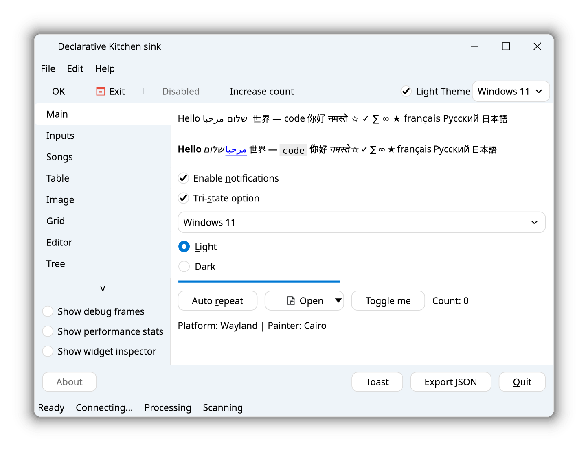
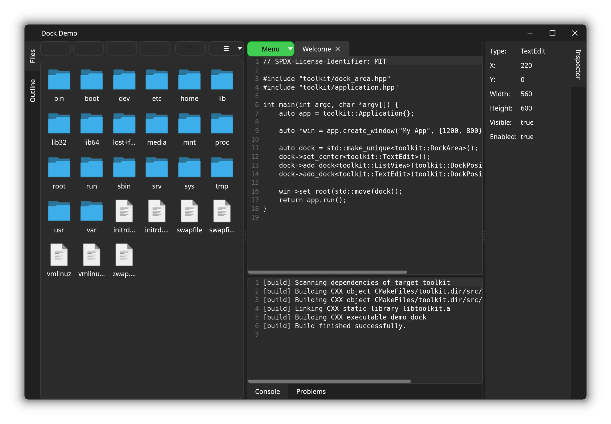
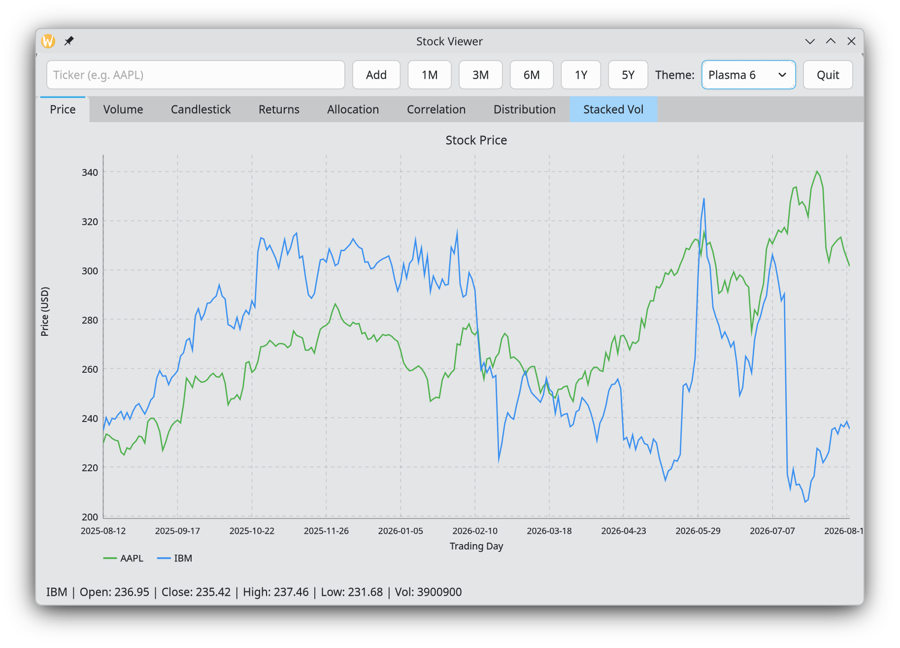
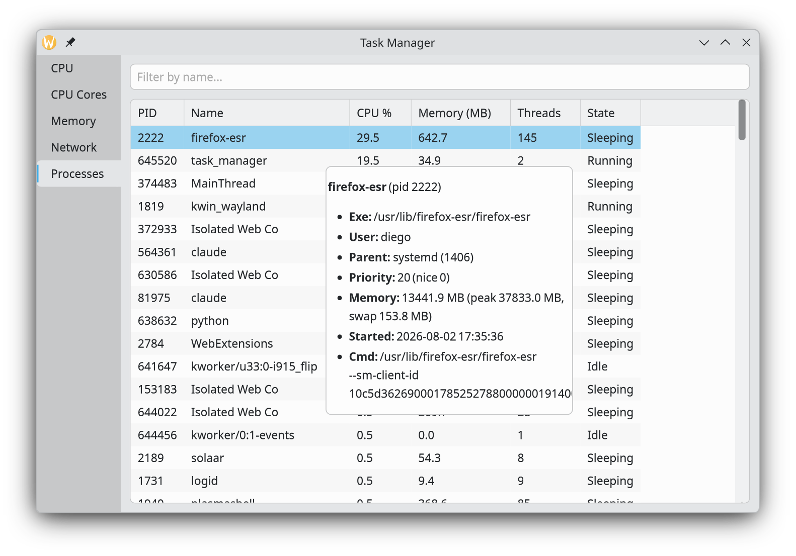
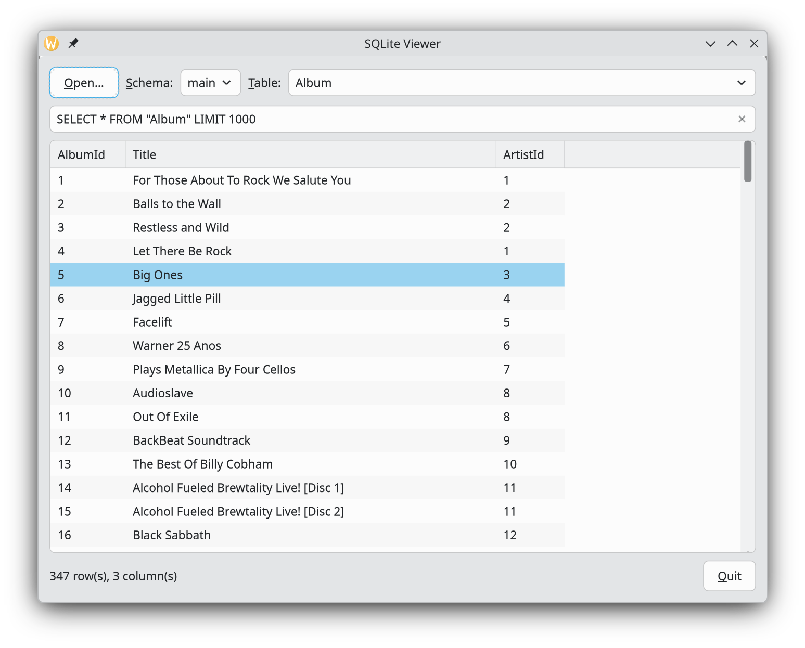

# Demos

SVision3 ships several standalone demo applications and tools under
`demo/` and `tools/` in the repository. Each one is a real, runnable
program that exercises a different slice of the toolkit — good places to
read real code, or to run and poke at directly.

:::note
Screenshots aren't included here yet — this page just describes what each
demo does. Build any of them with `cmake --build build/Release --target <name>`
(see the [tutorial](tutorial.md)) and run the resulting binary from the
repository root.
:::

## `demo`

A general widget showcase window ([demo/demo1.cpp](https://github.com/diegoiast/svision3/blob/main/demo/demo1.cpp)) — buttons, checkboxes,
comboboxes, list views, an icon grid, an `HtmlView`, menus, and file
dialogs, all in one window. A good first stop for seeing a broad set of
widgets wired up together.

## `demo_declarative`

Port of `demo` to [Declarative API](declarative.md) ([demo/demo_declarative.cpp`](https://github.com/diegoiast/svision3/blob/main/demo/demo_declarative.cpp)).
It has the exact same functionality as the first demo. Showcases how the declarative
API produces the same binary, using a smaller code base (in this example 200 lines less).

## `demo_dock`

A focused example ([demo/demo_dock.cpp](https://github.com/diegoiast/svision3/blob/main/demo/demo_dock.cpp)) of building an IDE-style layout
with [`DockArea`](widgets/dock_area.md) — a center editor with dockable
outline, inspector, and console panels around it, each independently
resizable.

## `demo_tray`

A minimal system tray example ([`demo/demo_tray.cpp`](https://github.com/diegoiast/svision3/blob/main/demo/demo_tray.cpp)): a
[`TrayIcon`](widgets/tray_icon.md) with a right-click action menu, backed
by a small window it shows and hides.

## `stock_viewer`

A small real-world app (`[demo/stock_viewer.cpp](https://github.com/diegoiast/svision3/blob/main/demo/stock_viewer.cpp)`) that fetches live stock
data over HTTP (`toolkit::net`) and renders it with the
[declarative chart API](declarative.md) — price and volume line charts
plus a candlestick chart, with a ticker input to fetch new symbols on
demand.

## `task_manager`

An OS task-manager clone ([demo/task_manager.cpp](https://github.com/diegoiast/svision3/blob/main/demo/task_manager.cpp)): live CPU (including a
per-core grid, like Windows Task Manager's "Logical processors" view) and
RAM usage charts, plus process and network tabs — a good example of
polling live system data into charts and a `TableView` on a timer.

## `sqlite_viewer`

A simple SQLite3 database viewer ([demo/sqlite_viewer.cpp](https://github.com/diegoiast/svision3/blob/main/demo/sqlite_viewer.cpp)) — open a
`.db` file, pick a table, and browse its contents in a `TableView`.
Demonstrates the `db::Connection` API documented under
[Data & networking](widgets.md).

