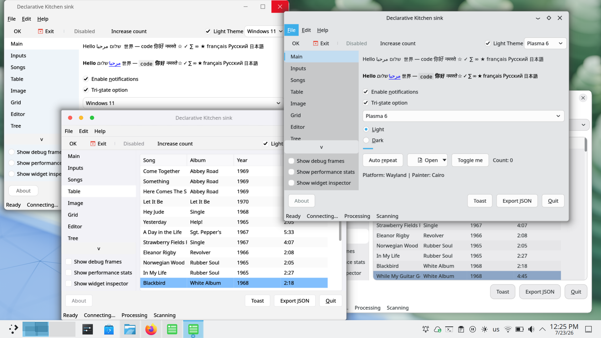

# SVision3

A C++20 GUI toolkit with Cairo-based rendering and native
platform backends for macOS, Windows, and Linux (X11 and Wayland).

[Get Started](tutorial.md){ .md-button .md-button--primary }
[Widgets & Modules](widgets.md){ .md-button }

## Features

The goal is a toolkit comparable to Qt Widgets, written in modern C++20 —
built on the STL and smart pointers, with minimal third-party dependencies
and no NIH syndrome. Native painters are used where it matters (GDI+ on
Windows, CoreGraphics on macOS, Cairo on Linux), which keeps binaries small:
demos are about 4.6&nbsp;MB stripped on Linux and about 2.8&nbsp;MB on Windows.

-  Basic widgets (buttons, inputs, checkbox, popups etc).
-  Listview with filtering (on background thread).
-  Layouts (vertical, horizontal, box and dialog).
-  Charts
-  Native look alike themes.
-  Client side decorations.
-  Basic DB support (SQLite3 support out of the box).
-  API for geting native file dialogs (using NFD), with API to use also use
   toolkit based file dialogs.
-  Markdown support for widgets, and tooltips (using litehtml and md4c).
-  API based on opendesktop to load icon themes.
-  API to save the whole UI state into JSON, and reload it later on.

API design:

- All memory is gruaded by smart pointers (you create using `std::make_shared`
  and get references to widgets using `std::weak_ptr`.
- All widgets have a `get_...()` method that returns a value.
- All widgets have a `set_...()` that returns a reference to the pointer (so
  you can chain `set_...()` calls.
- All events are callback based, with a function (but you can overides the
 `handle_..()` method in your library.
- UTF8 native, with UTF8 iterator class.
- Command based API - you create a `Command`, which can be added to a toolbar, menu
  or attached directly to a button. All will trigger the same callback from the command.
- The widgets draw through a theme. Meaning - change theme, widget display changes.
- Painting is done via thing wrappers against platform. See Painter class.
- Text drawing, and image loading is still abstracted using similar abstractions.
- You as a developer can still opt out of defaults, and choose your own image loader,
  platform API, graphics loader and text rendering.
- Fluent/declarative API - is WIP. A simple header on top of the basic API.

## Platform matrix

All all platforms we support the native way of drawing, but an OpenGL 2.1 API
is available for painting. Still WIP, as it depends on native APIs.

| Platform | Windowing | Rendering backend | Selection |
|----------|-----------|--------------------|-----------|
| macOS    | Cocoa/AppKit | CoreGraphics (default) or OpenGL 2.1 | `SVISION_PAINT=opengl` |
| Windows  | Win32     | GDI+ (default) or OpenGL 2.1 | `SVISION_PAINT=opengl` |
| Linux    | X11 / Wayland | Cairo (default) or OpenGL 2.1 | `SVISION_PAINT=cairo` / `SVISION_PAINT=opengl` |

Ready to try it? Head to the [tutorial](tutorial.md) to build your first
window, or browse the [widget and module reference](widgets.md).
