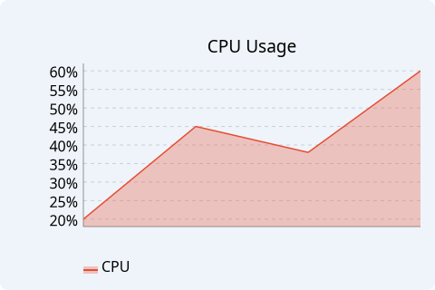
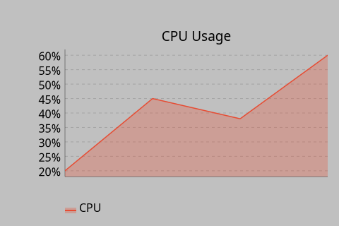
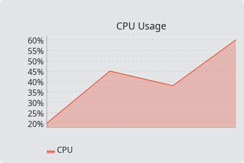
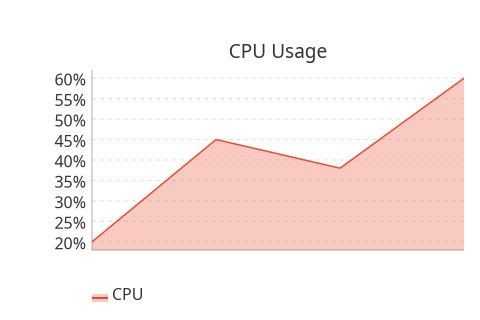

# AreaChart

`#include "toolkit/charts/area_chart.hpp"`

A multi-series filled line (area) chart with grid, legend, hover
tooltips, and pan & zoom (see the [charts overview](charts_overview.md)).
Inherits `Widget`.

<Tabs>
<TabItem value="macos" label="macOS">


</TabItem>
<TabItem value="material" label="Material">


</TabItem>
<TabItem value="windows-11" label="Windows 11">



</TabItem>
<TabItem value="windows-95" label="Windows 95">



</TabItem>
<TabItem value="plasma-6" label="Plasma 6">



</TabItem>
<TabItem value="gnome" label="GNOME">



</TabItem>
</Tabs>

## Data types

```cpp
struct AreaDataPoint { float x, y; std::string label; };
struct AreaSeries { std::string name; Color line_color; Color fill_color; std::vector<AreaDataPoint> points; };
```

## Example

```cpp
auto chart = std::make_unique<toolkit::AreaChart>();
chart->set_y_unit_suffix("%");
chart->add_series({"CPU", toolkit::Color::rgb(0.9f, 0.3f, 0.2f),
                    toolkit::Color::rgba(0.9f, 0.3f, 0.2f, 0.3f), {{0, 20, ""}, {1, 45, ""}}});
```

## Construction

```cpp
AreaChart();
```

## API

| Member | Description |
|--------|-------------|
| `add_series(AreaSeries)` / `clear_series()` / `series_count()` | Manage data series |
| `set_title(std::string)` | Chart title |
| `set_x_label(std::string)` / `set_y_label(std::string)` | Axis labels |
| `set_y_unit_suffix(std::string)` | Appended to Y-axis tick labels, e.g. `"%"` → `"20%"` |
| `set_show_grid(bool)` / `set_show_legend(bool)` | Toggle chrome |
| `set_auto_range(bool)` | Auto-fit the Y range to data (default: on) |
| `set_y_range(float min, float max)` | Fix the Y range explicitly (disables auto-range) |

## Callbacks

| Callback | Description |
|----------|-------------|
| `on_hover` — `std::function<void(size_t series_idx, size_t point_idx)>` | Fired as the pointer hovers a data point |
