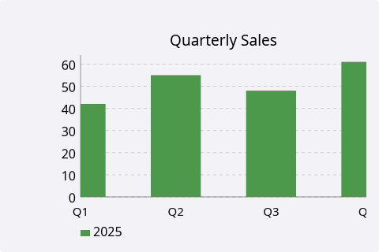
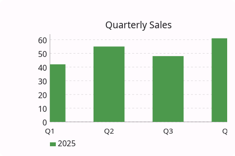
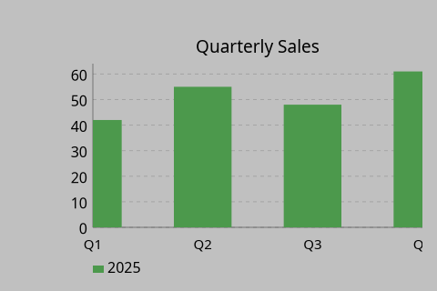
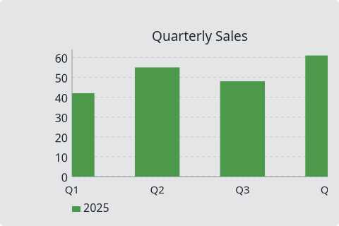

# BarChart

`#include "toolkit/charts/bar_chart.hpp"`

A multi-series (grouped) bar chart with grid, legend, hover tooltips, and
pan & zoom (see the [charts overview](charts_overview.md)). Inherits
`Widget`.

=== "macOS"
    

=== "Material"
    

=== "Windows 11"
    

=== "Windows 95"
    

=== "Plasma 6"
    

=== "GNOME"
    

## Data types

```cpp
struct BarDataPoint { float x, y; std::string label; std::string detail; Color color; };
struct BarSeries { std::string name; Color default_color; std::vector<BarDataPoint> points; };
```

`BarDataPoint::color` overrides `BarSeries::default_color` for an
individual bar when set.

## Example

```cpp
auto chart = std::make_unique<toolkit::BarChart>();
chart->add_series({"2025", toolkit::Color::rgb(0.3f, 0.6f, 0.3f),
                    {{0, 42, "Q1", "", {}}, {1, 55, "Q2", "", {}}}});
```

## Construction

```cpp
BarChart();
```

## API

| Member | Description |
|--------|-------------|
| `add_series(BarSeries)` / `clear_series()` / `series_count()` | Manage data series |
| `set_title(std::string)` | Chart title |
| `set_x_label(std::string)` / `set_y_label(std::string)` | Axis labels |
| `set_show_grid(bool)` / `set_show_legend(bool)` | Toggle chrome |

## Callbacks

| Callback | Description |
|----------|-------------|
| `on_hover` — `std::function<void(size_t series_idx, size_t bar_idx)>` | Fired as the pointer hovers a bar |
