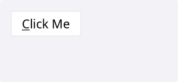
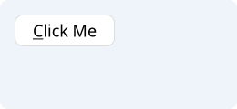
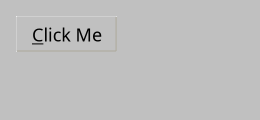
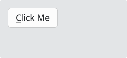

# Button

`#include "toolkit/button.hpp"`

A clickable push button with optional icon, checkable/toggle mode, an
attached dropdown `Menu`, and an attached `Command` for keyboard-shortcut
sync. Inherits `Widget`.

Featrures:

- Can have an icon at its side.
- Can be disabled.
- Can be checked (push and they remain "clicked").
- Can be flat (borders are drawed only when hovered with the mouse).
- Has tooltips (also markdown tooltips).
- Can have a command attached - when the button is clicked, the command is triggerd.
- Have an auto repeat function, while button is pressed the clicked event
  will be periodically triggered.


=== "macOS"
    

=== "Material"
    

=== "Windows 11"
    

=== "Windows 95"
    

=== "Plasma 6"
    

=== "GNOME"
    

## Example

```cpp
auto btn = std::make_unique<toolkit::Button>("&Quit");
btn->on_click = [window] { window->close(); };
root->add_widget(std::move(btn));
```

## Construction

```cpp
explicit Button(std::string text);
```

`text` may contain a `&` mnemonic, e.g. `"&Quit"` renders as **Q**uit and
binds Alt+Q on platforms that support it.

## API

| Member | Description |
|--------|-------------|
| `set_text(std::string)` / `text()` | Button label |
| `set_icon(Icon)` / `clear_icon()` | Icon shown alongside the label (`Icon` is `std::shared_ptr<ImageData>`) |
| `set_flat(bool)` / `is_flat()` | Borderless/flat rendering |
| `set_checkable(bool)` / `is_checkable()` | Enable toggle (on/off) behavior |
| `set_checked(bool)` / `is_checked()` | Toggle state, when checkable |
| `set_padding(Margins)` / `get_padding()` | Override the default content padding |
| `set_auto_repeat(bool, delay=0.5f, interval=0.4f)` / `stop_auto_repeat()` | Repeatedly fire `on_click` while held down |
| `is_hovered()` / `is_pressed()` | Current pointer state |
| `set_command(Command::Ptr)` / `command()` | Bind a `Command`; button text/enabled state stays in sync with it |
| `set_menu(std::shared_ptr<Menu>)` / `menu()` / `has_menu()` | Attach a dropdown menu shown on click |

## Callbacks

| Callback | Description |
|----------|-------------|
| `on_click` — `std::function<void()>` | Fired on activation (click, Space/Enter when focused, or mnemonic) |
| `on_toggle` — `std::function<void(bool)>` | Fired when a checkable button's state changes |
