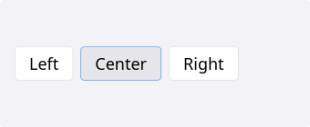
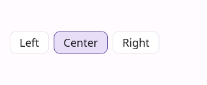
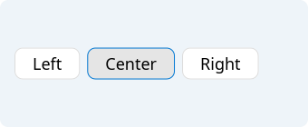
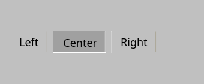
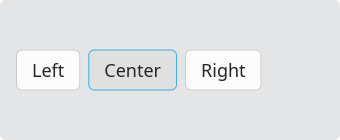
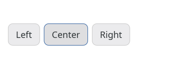

# ButtonGroup

`#include "toolkit/button_group.hpp"`

A convenience container that is itself an `HBoxLayout`: it arranges a row
of `Button`s and makes them behave like a mutually exclusive toggle group
(only one button in the group is checked at a time), similar to a segmented
control.

=== "macOS"
    

=== "Material"
    

=== "Windows 11"
    

=== "Windows 95"
    

=== "Plasma 6"
    

=== "GNOME"
    

## Example

```cpp
auto group = std::make_unique<toolkit::ButtonGroup>();
group->add_button("Left");
group->add_button("Center");
group->add_button("Right");
group->on_change = [](int index) { /* ... */ };
root->add_widget(std::move(group));
```

## Construction

```cpp
ButtonGroup group;
```

## API

| Member | Description |
|--------|-------------|
| `add_button(std::string text)` → `Button&` | Creates, adds, and registers a new button in the group |
| `add_button(std::unique_ptr<Button>)` → `Button&` | Adds and registers an existing button |
| `set_checked(int index)` | Programmatically select a button by index |
| `checked_index()` → `int` | Currently checked index, or `-1` |
| `checked_button()` → `Button*` | Currently checked button, or `nullptr` |

## Callbacks

| Callback | Description |
|----------|-------------|
| `on_change` — `std::function<void(int)>` | Fired with the newly checked index whenever selection changes |
