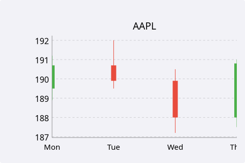
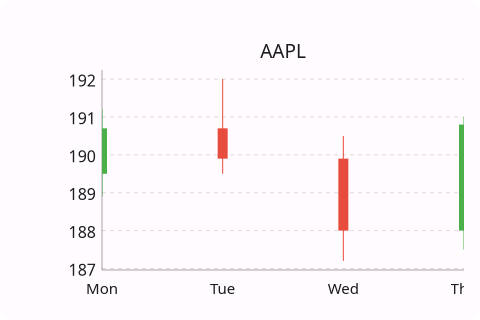
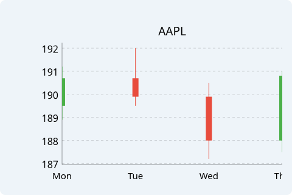
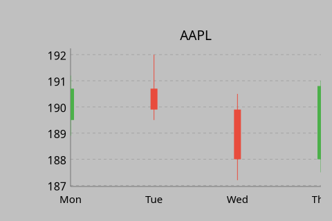
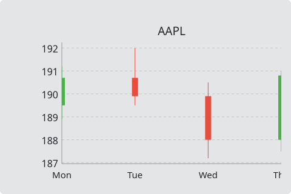
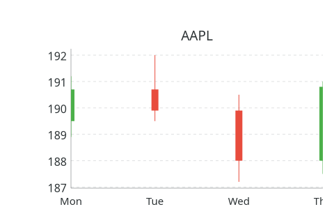

# CandlestickChart

`#include "toolkit/charts/candlestick_chart.hpp"`

An OHLC (open/high/low/close) candlestick chart, e.g. for financial/stock
data, with grid, hover tooltips, and pan & zoom (see the
[charts overview](charts_overview.md)). Inherits `Widget`.

=== "macOS"
    

=== "Material"
    

=== "Windows 11"
    

=== "Windows 95"
    

=== "Plasma 6"
    

=== "GNOME"
    

## Data types

```cpp
struct CandlestickData { float x, open, high, low, close; std::string label; };
struct CandlestickSeries {
    std::string name;
    Color up_color = Color::rgb(0.30f, 0.69f, 0.29f);
    Color down_color = Color::rgb(0.91f, 0.30f, 0.24f);
    std::vector<CandlestickData> candles;
};
```

`up_color`/`down_color` default to green/red and color each candle based
on whether `close >= open`.

## Example

```cpp
auto chart = std::make_unique<toolkit::CandlestickChart>();
chart->add_series({"AAPL", {}, {}, {
    {0, 189.5f, 191.2f, 188.9f, 190.7f, "Mon"},
    {1, 190.7f, 192.0f, 189.5f, 189.9f, "Tue"},
}});
```

## Construction

```cpp
CandlestickChart();
```

## API

| Member | Description |
|--------|-------------|
| `add_series(CandlestickSeries)` / `clear_series()` / `series_count()` | Manage data series |
| `set_title(std::string)` | Chart title |
| `set_x_label(std::string)` / `set_y_label(std::string)` | Axis labels |
| `set_show_grid(bool)` | Toggle the grid |

## Callbacks

| Callback | Description |
|----------|-------------|
| `on_hover` — `std::function<void(size_t series_idx, size_t candle_idx)>` | Fired as the pointer hovers a candle |
