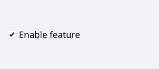
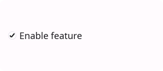
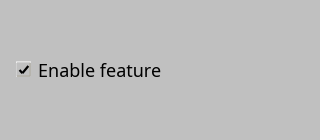
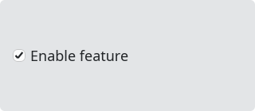

# Checkbox

`#include "toolkit/checkbox.hpp"`

A labeled checkbox with two-state and optional tri-state (partial) modes.
Inherits `Widget`. You can also `set_enabled(false)` to the widget,
and it will not be clickable by the user, and drawed in gray (depending on palette
and Style).

<Tabs>
<TabItem value="macos" label="macOS">



</TabItem>
<TabItem value="material" label="Material">



</TabItem>
<TabItem value="windows-11" label="Windows 11">


</TabItem>
<TabItem value="windows-95" label="Windows 95">



</TabItem>
<TabItem value="plasma-6" label="Plasma 6">



</TabItem>
<TabItem value="gnome" label="GNOME">


</TabItem>
</Tabs>

## Example

```cpp
auto cb = std::make_unique<toolkit::Checkbox>("&Enable feature");
cb->on_toggle = [](bool checked) { /* ... */ };
```

## Construction

```cpp
explicit Checkbox(std::string text);
```

## API

| Member | Description |
|--------|-------------|
| `checked()` / `set_checked(bool)` | Simple on/off state |
| `check_state()` / `set_check_state(CheckState)` | Full state, including `Partial` |
| `is_tri_state()` / `set_tri_state(bool)` | Enable the third, partially-checked state |

`CheckState` is `Unchecked \| Checked \| Partial` (defined in `types.hpp`).

## Callbacks

| Callback | Description |
|----------|-------------|
| `on_toggle` — `std::function<void(bool)>` | Fired with the simplified checked/unchecked value |
| `on_state_change` — `std::function<void(CheckState)>` | Fired with the full tri-state value |
