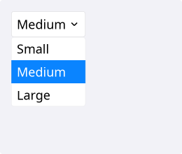
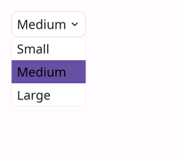
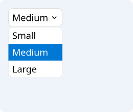
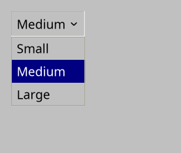
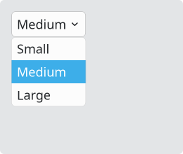
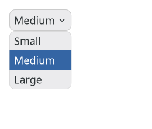

# Combobox

`#include "toolkit/combobox.hpp"`

A dropdown selection widget over a fixed list of strings. Inherits
`Widget`.

=== "macOS"
    

=== "Material"
    

=== "Windows 11"
    

=== "Windows 95"
    

=== "Plasma 6"
    

=== "GNOME"
    

## Example

```cpp
auto combo = std::make_unique<toolkit::Combobox>(
    std::vector<std::string>{"Small", "Medium", "Large"});
combo->set_selected(1);
combo->on_change = [](int index) { /* ... */ };
```

## Construction

```cpp
explicit Combobox(std::vector<std::string> items = {});
```

## API

| Member | Description |
|--------|-------------|
| `set_items(std::vector<std::string>)` | Replace the item list |
| `set_selected(int index)` / `selected()` | Selected item index (`-1` if none) |
| `selected_text()` | Text of the currently selected item |

## Callbacks

| Callback | Description |
|----------|-------------|
| `on_change` — `std::function<void(int)>` | Fired with the new index when the selection changes |
