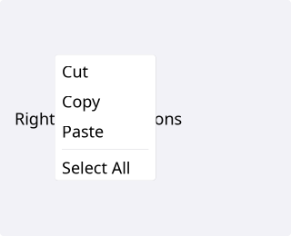
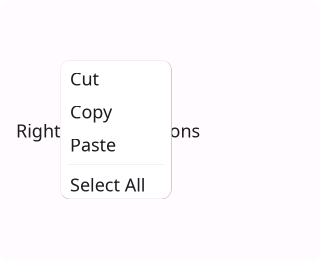
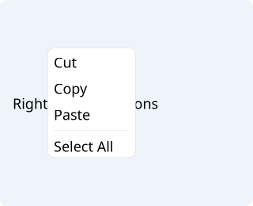
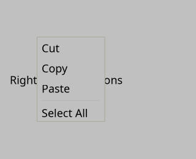
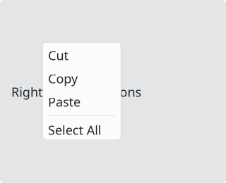
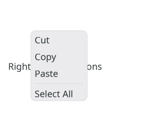

# ContextMenu

`#include "toolkit/context_menu.hpp"`

A one-shot popup menu (right-click menu) built from a list of
[`MenuItem`](menu.md#menuitem)s. Unlike [`Menu`](menu.md), it isn't
attached to a widget beforehand — construct it with its items and call
`show()` at the click position.

=== "macOS"
    

=== "Material"
    

=== "Windows 11"
    

=== "Windows 95"
    

=== "Plasma 6"
    

=== "GNOME"
    

## Example

```cpp
using toolkit::MenuItem;
auto menu = toolkit::ContextMenu({
    MenuItem::action("Cut", [] { cut(); }),
    MenuItem::action("Copy", [] { copy(); }),
    MenuItem::action("Paste", [] { paste(); }),
});
menu.show(window, click_pos);
```

## Construction

```cpp
explicit ContextMenu(std::vector<MenuItem> items);
```

## API

| Member | Description |
|--------|-------------|
| `show(Window *window, Point position)` | Display the popup at a window-relative position |
