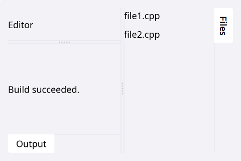
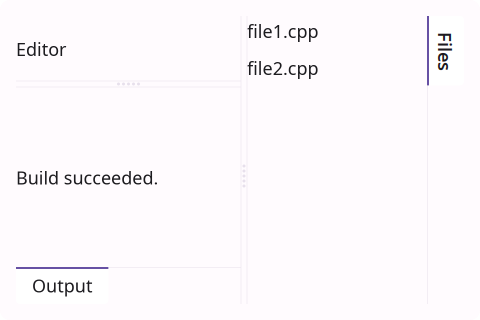
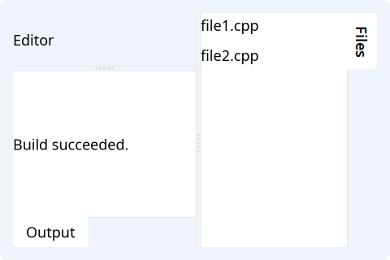
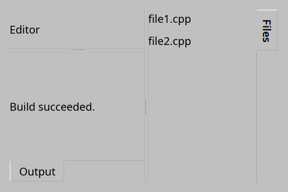
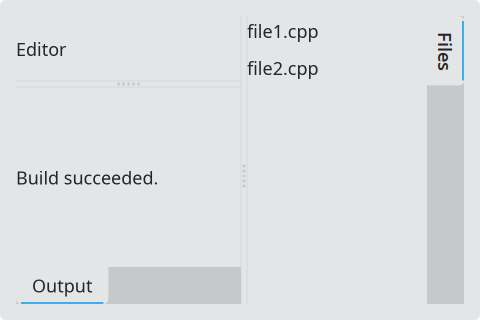
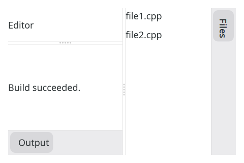

# DockArea

`#include "toolkit/dock_area.hpp"`

Manages a center widget plus up to three docked [`TabWidget`](tab_widget.md)
panels (west, south, east), automatically building a nested
[`Splitter`](splitter.md) tree so every dock boundary is drag-resizable.
All docks must be added before the `DockArea` is first given a non-zero
rect — i.e. before the window is shown. Inherits `Splitter`.

=== "macOS"
    

=== "Material"
    

=== "Windows 11"
    

=== "Windows 95"
    

=== "Plasma 6"
    

=== "GNOME"
    

## Example

```cpp
auto dock = std::make_unique<toolkit::DockArea>();
dock->set_center(make_editor());
dock->add_dock(toolkit::DockPosition::West, "Files", make_file_tree());
dock->add_dock(toolkit::DockPosition::South, "Output", make_log_view());
```

## Construction

```cpp
DockArea();
```

## API

| Member | Description |
|--------|-------------|
| `set_center(std::shared_ptr<Widget>)` / `get_center()` | The main, non-dockable content area |
| `add_dock(DockPosition pos, std::string const &title, std::shared_ptr<Widget> content)` → `weak_ptr<Widget>` | Dock a widget in a new tab at `pos`; returns the content, not the hosting `TabWidget` |
| `dock_tab_widget(DockPosition pos)` → `weak_ptr<TabWidget>` | The `TabWidget` hosting a given dock position |
| `set_dock_size(DockPosition pos, float size)` / `dock_size(DockPosition pos)` | Pixel size along the dock's splitter axis (a soft request — content minimum size can still override it) |

`DockPosition` is `West \| South \| East`. `default_dock_size` is `220.0f`.
