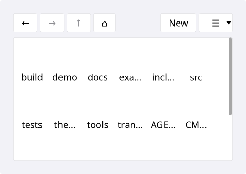
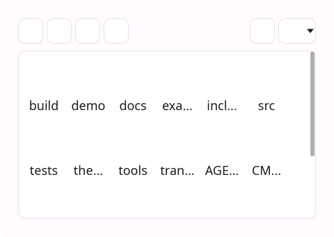
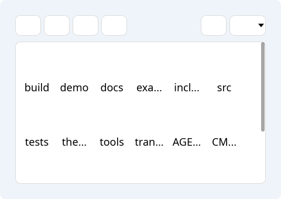
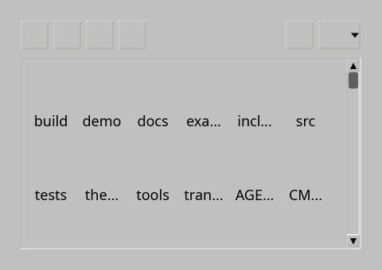
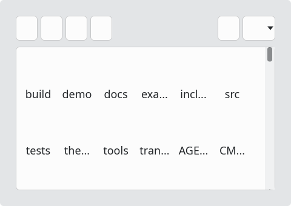
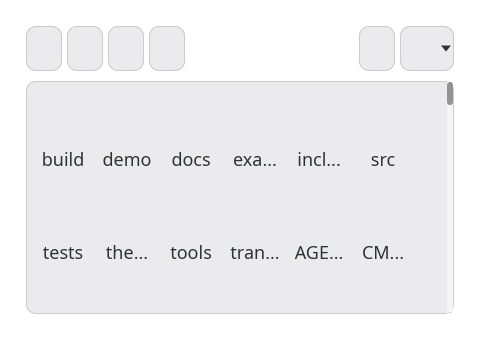

# FileBrowserWidget

`#include "toolkit/file_browser_widget.hpp"`

A full file-browser panel — path bar, back/forward/up navigation, list/
icon/detail view modes, and optional dialog chrome (filename field,
OK/Cancel) — used to build [`FileDialog`](file_dialog.md) and
[`DirectoryDialog`](directory_dialog.md), and reusable standalone in
"browser mode". Inherits `VBoxLayout`.

=== "macOS"
    

=== "Material"
    

=== "Windows 11"
    

=== "Windows 95"
    

=== "Plasma 6"
    

=== "GNOME"
    

## Example

```cpp
auto browser = std::make_unique<toolkit::FileBrowserWidget>();
browser->set_browser_mode(true);
browser->navigate_to("/home/user/projects");
browser->on_file_activated = [](std::string const &path) { open_file(path); };
```

## Construction

```cpp
FileBrowserWidget();
```

## API

| Member | Description |
|--------|-------------|
| `set_current_path(std::string)` / `navigate_to(std::string)` (alias) / `current_path()` | Current directory |
| `navigate_home()` | Jump to the user's home directory |
| `set_filename(std::string_view)` / `selected_path()` | Filename field (dialog mode) |
| `set_ok_label(std::string_view)` | Label for the OK button |
| `set_browser_mode(bool)` / `browser_mode()` | Hide the filename/OK/Cancel bar to use as a plain embedded browser |
| `set_sort_order(SortOrder)` / `sort_order()` | `Name \| Time` |
| `set_dirs_first(bool)` / `dirs_first()` | List directories before files |
| `set_show_hidden(bool)` / `show_hidden()` | Show dotfiles |
| `set_file_must_exist(bool)` / `file_must_exist()` | Validate the selected file exists (dialog mode) |
| `set_view_mode(ViewMode)` / `view_mode()` | `List \| Icons \| Details` |
| `icon_grid()` → `IconGrid*` | Access the underlying icon grid for further customization |

## Callbacks

| Callback | Description |
|----------|-------------|
| `on_file_activated` — `std::function<void(std::string const &path)>` | A file was opened/double-clicked |
| `on_path_changed` — `std::function<void(std::string const &path)>` | Current directory changed |
| `on_ok` / `on_cancel` / `on_up` / `on_new` — `std::function<void()>` | Dialog-mode button actions |
