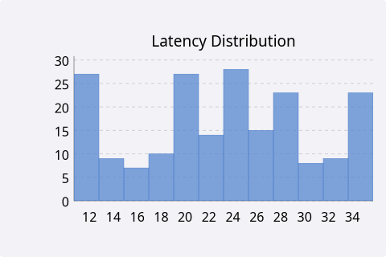
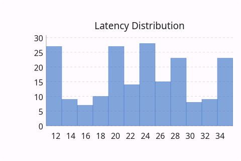
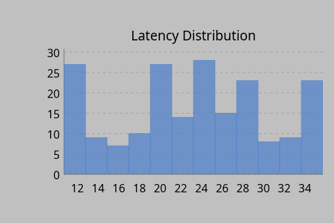
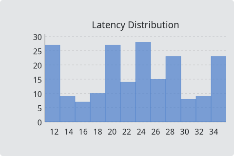

# Histogram

`#include "toolkit/charts/histogram.hpp"`

Bins raw values into a configurable number of buckets and renders them as
a bar histogram, with grid, legend, hover tooltips, and pan & zoom (see
the [charts overview](charts_overview.md)). Inherits `Widget`.

=== "macOS"
    

=== "Material"
    

=== "Windows 11"
    

=== "Windows 95"
    

=== "Plasma 6"
    

=== "GNOME"
    

## Data type

```cpp
struct HistogramSeries { std::string name; Color color; std::vector<float> values; };
```

Pass raw (unbinned) values — `Histogram` computes the bins itself.

## Example

```cpp
auto chart = std::make_unique<toolkit::Histogram>();
chart->set_bin_count(30);
chart->add_series({"Latency (ms)", toolkit::Color::rgb(0.3f, 0.5f, 0.8f), latency_samples});
```

## Construction

```cpp
Histogram();
```

## API

| Member | Description |
|--------|-------------|
| `add_series(HistogramSeries)` / `clear_series()` / `series_count()` | Manage data series |
| `set_bin_count(int)` | Number of bins (default: 20) |
| `set_title(std::string)` | Chart title |
| `set_x_label(std::string)` / `set_y_label(std::string)` | Axis labels |
| `set_show_grid(bool)` / `set_show_legend(bool)` | Toggle chrome |

## Callbacks

| Callback | Description |
|----------|-------------|
| `on_hover` — `std::function<void(size_t series_idx, size_t bin_idx)>` | Fired as the pointer hovers a bin |
