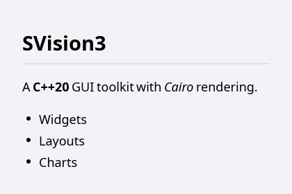
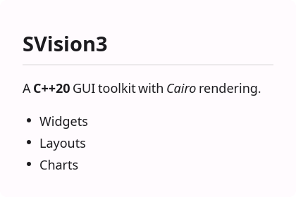
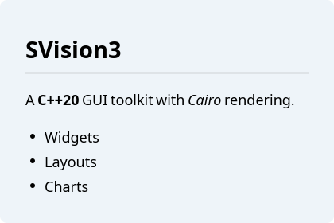
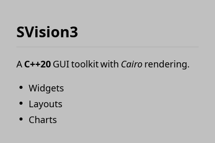
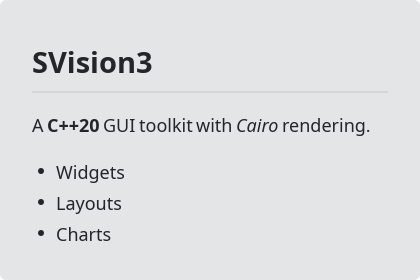
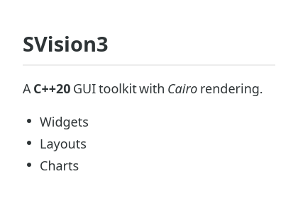

# HtmlView

`#include "toolkit/html_view.hpp"`

Renders Markdown or HTML content using [litehtml](https://github.com/litehtml/litehtml).
This is the base class behind [`RichLabel`](rich_label.md); use `HtmlView`
directly when you need a scrollable document rather than an inline rich
text label. Inherits `Widget`.

=== "macOS"
    

=== "Material"
    

=== "Windows 11"
    

=== "Windows 95"
    

=== "Plasma 6"
    

=== "GNOME"
    

## Example

```cpp
auto view = std::make_unique<toolkit::HtmlView>();
view->set_markdown("# Hello\n\nThis is **markdown**.");
view->on_link_click = [](std::string const &href) { open_url(href); };
```

## Construction

```cpp
HtmlView();
```

## API

| Member | Description |
|--------|-------------|
| `set_html(std::string const&, std::string const &base_url = "")` / `html()` | Load raw HTML, resolving relative links/images against `base_url` |
| `set_markdown(std::string const&)` | Load and render Markdown |
| `set_css(std::string light_css, std::string dark_css = {})` | Provide stylesheets for light/dark theme rendering |
| `set_content_margin(int px)` | Inner content margin |
| `set_content_max_width(int px)` | Cap content width (`0` = unconstrained) |
| `content_width()` | Measured content width after layout |
| `set_draw_frame(bool)` | Draw a bordered frame around the view |

## Callbacks

| Callback | Description |
|----------|-------------|
| `on_link_click` — `std::function<void(std::string const&)>` | Fired with the href when a link is clicked |
