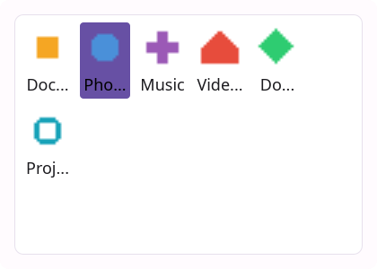
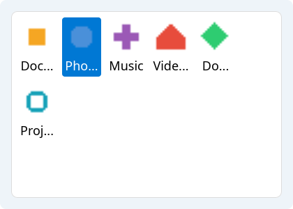
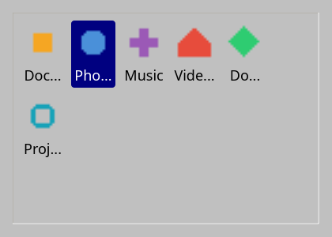
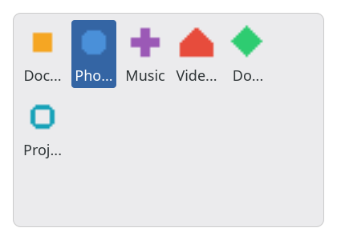

# IconGrid

`#include "toolkit/icon_grid.hpp"`

A scrollable grid of icons backed by an [`ItemModel`](item_model.md), with
single/multi selection, rubber-band (drag) selection, and keyboard
navigation — the layout used by file/icon browsers. Inherits
`ScrollableWidget`.


<Tabs>
<TabItem value="macos" label="macOS">


</TabItem>
<TabItem value="material" label="Material">



</TabItem>
<TabItem value="windows-11" label="Windows 11">



</TabItem>
<TabItem value="windows-95" label="Windows 95">



</TabItem>
<TabItem value="plasma-6" label="Plasma 6">


</TabItem>
<TabItem value="gnome" label="GNOME">



</TabItem>
</Tabs>

## Construction

```cpp
explicit IconGrid(std::shared_ptr<ItemModel> model);
```

## API

| Member | Description |
|--------|-------------|
| `set_model(std::shared_ptr<ItemModel>)` / `model()` | Data source |
| `set_icon_size(int)` / `icon_size()` | Requested icon size in pixels |
| `set_scale_icons(bool)` / `scale_icons()` | Scale icons that don't match `icon_size` |
| `set_selected(std::optional<size_t>)` / `selected_index()` | Single-selection cursor |
| `selected_indices()` | All currently selected indices (multi-select) |
| `toggle_selection(size_t)` | Add/remove one index from the selection |
| `select_range(size_t from, size_t to)` | Select a contiguous range |
| `select_in_rect(Rect const&)` / `rubber_selection_rect()` | Rubber-band selection support |

## Callbacks

| Callback | Description |
|----------|-------------|
| `on_selection_changed` — `std::function<void(std::set<size_t> const&)>` | Fired when the selection set changes |
| `on_item_activated` — `std::function<void(size_t)>` | Fired on double-click / Enter on an item |
| `on_back_requested` — `std::function<void()>` | Fired on a "navigate up" gesture (e.g. Backspace) |
