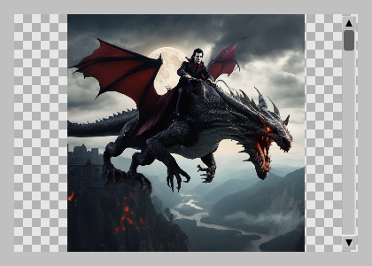
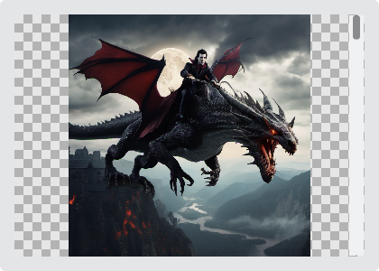
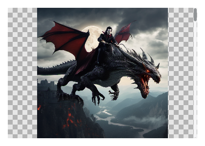

# ImageWidget

`#include "toolkit/image_widget.hpp"`

Displays a bitmap image with zoom and panning, and an optional
checkerboard background for transparency. Inherits `ScrollableWidget`.

=== "macOS"
    

=== "Material"
    

=== "Windows 11"
    

=== "Windows 95"
    

=== "Plasma 6"
    

=== "GNOME"
    

## Example

```cpp
auto viewer = std::make_unique<toolkit::ImageWidget>();
viewer->load("photo.png");
viewer->fit_to_widget();
```

## Construction

```cpp
ImageWidget();
```

## API

| Member | Description |
|--------|-------------|
| `load(std::string_view path)` | Load an image from a file path |
| `load(const uint8_t *data, size_t size)` | Load an image from an in-memory buffer |
| `set_image(std::shared_ptr<ImageData>)` | Set an already-decoded image directly |
| `set_show_checkerboard(bool)` / `show_checkerboard()` | Toggle the transparency checkerboard backdrop |
| `set_zoom(float)` / `zoom()` | Zoom factor |
| `fit_to_widget()` | Reset zoom so the image fits the current widget size |
