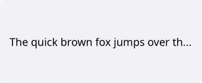
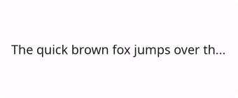
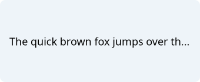
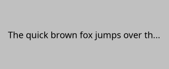
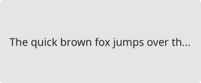
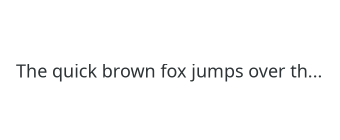

# Label

`#include "toolkit/label.hpp"`

A static text display. Multi-line, optionally shrinkable/elidable, and
never intercepts mouse input itself (`blocks_hit_test()` is `false`) — so a
label with a `buddy` widget transparently forwards focus/click-through to
that buddy, mirroring [Qt's "buddy" pattern](https://doc.qt.io/qt-6/qlabel.html#setBuddy) for mnemonic labels next to
inputs. Inherits `Widget`.

This widget can only display plain text. If you need to display rich text, use
[RichLabel](rich_label.md).

<Tabs>
<TabItem value="macos" label="macOS">



</TabItem>
<TabItem value="material" label="Material">



</TabItem>
<TabItem value="windows-11" label="Windows 11">



</TabItem>
<TabItem value="windows-95" label="Windows 95">



</TabItem>
<TabItem value="plasma-6" label="Plasma 6">



</TabItem>
<TabItem value="gnome" label="GNOME">



</TabItem>
</Tabs>

## Example

```cpp
auto label = std::make_unique<toolkit::Label>("&Name:");
auto input = std::make_unique<toolkit::LineInput>();
label->set_buddy(input.get());
```

## Construction

```cpp
Label();
explicit Label(std::string text);
```

`text` may contain a `&` mnemonic (e.g. `"&Name:"`) which, combined with
`set_buddy()`, focuses the buddy widget when the mnemonic is triggered.

## API

| Member | Description |
|--------|-------------|
| `set_text(std::string const&)` / `text()` | Label content |
| `set_buddy(Widget*)` / `buddy()` | Widget that receives focus when this label's mnemonic fires |
| `set_color(Color const&)` | Override text color |
| `set_font_size(float)` | Override font size |
| `set_shrinkable(bool)` / `shrinkable()` | Allow the label to shrink below its natural text size |
| `set_alignment(Alignment)` / `alignment()` | `Alignment::Fill \| Start \| Center \| End` |
| `set_elide(bool)` / `elide()` | Elide (`…`) text that doesn't fit, instead of clipping |
