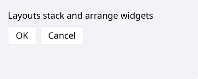
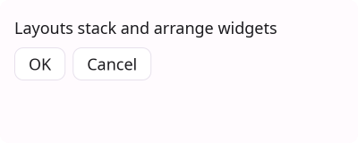
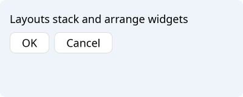
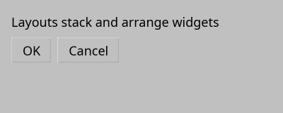
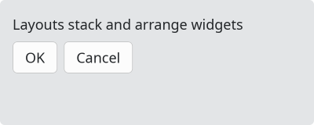
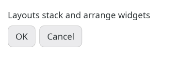

# Layouts

`#include "toolkit/layout.hpp"`

All layouts derive from `AbstractLayout` (itself a `Widget`), which owns
margins/spacing and the shared plumbing (painting, mouse/key dispatch,
focus traversal) that delegates to each layout's `for_each_child()`.
Children are owned via `shared_ptr`; every `add_*` call hands back a
`weak_ptr` to what it just stored, since a layout keeping a `shared_ptr` in
a sibling's callback would form a reference cycle that never frees.

=== "macOS"
    

=== "Material"
    

=== "Windows 11"
    

=== "Windows 95"
    

=== "Plasma 6"
    

=== "GNOME"
    

## Example

```cpp
auto root = std::make_unique<toolkit::VBoxLayout>();
root->set_margins({20, 20, 20, 20});
root->set_spacing(12);
root->add_widget(std::make_unique<toolkit::Label>("Hello, world!"));
```

## AbstractLayout (common API)

| Member | Description |
|--------|-------------|
| `set_margins(Margins const&)` / `get_margins()` | Outer margins |
| `set_spacing(float)` | Gap between children |

## VBoxLayout / HBoxLayout

Stack children vertically or horizontally.

```cpp
VBoxLayout();
HBoxLayout();
```

| Member | Description |
|--------|-------------|
| `add_widget(shared_ptr<Widget>, int stretch = 0, Alignment align = ...)` | Append a child; `stretch` distributes extra space, `align` is cross-axis alignment |
| `add<T>(int stretch = 0, Alignment align = ...)` | Construct a `T` in place and add it, returning `weak_ptr<T>` |
| `insert_widget(...)` *(HBoxLayout only)* | Insert at a specific index |
| `clear_items()` | Remove all children |
| `release_item(int index)` → `shared_ptr<Widget>` | Detach and return ownership of a child |
| `items()` | Read-only access to `{widget, stretch, alignment}` entries |

## GridLayout

Places children at `(row, col)`, with optional row/column spans.

| Member | Description |
|--------|-------------|
| `add_widget(widget, row, col, rowspan=1, colspan=1, h_align=Fill, v_align=Fill)` | Place a child |
| `add<T>(row, col, ...)` | Construct-and-place variant |
| `set_column_stretch(col, stretch)` / `set_row_stretch(row, stretch)` | Extra-space distribution per row/column |
| `set_spacing(float)` / `set_column_spacing(float)` / `set_row_spacing(float)` | Gaps |

## StackedLayout

Shows exactly one child at a time (like a `TabWidget`'s content area,
without the tab bar).

| Member | Description |
|--------|-------------|
| `add_widget(shared_ptr<Widget>)` / `add<T>()` | Add a page |
| `remove_widget(int index)` / `swap_widgets(int a, int b)` | Manage pages |
| `set_current(int)` / `current()` | Visible page index |
| `count()` | Number of pages |

## FormLayout

Two-column label/field rows.

| Member | Description |
|--------|-------------|
| `add_row(shared_ptr<Widget> label, shared_ptr<Widget> field)` → `{weak_ptr label, weak_ptr field}` | Add a row; either side may be null |
| `set_label_spacing(float)` | Gap between the label and field columns |
