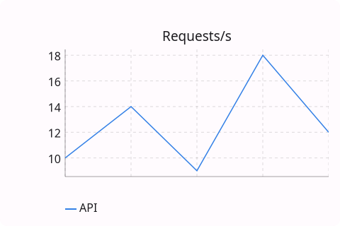
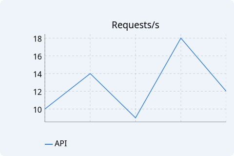
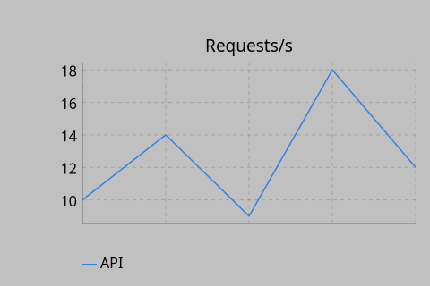
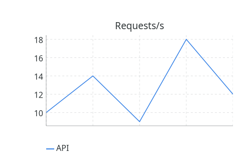

# LineChart

`#include "toolkit/charts/line_chart.hpp"`

A multi-series line chart with grid, legend, hover tooltips, and
scroll/drag pan & zoom (see the [charts overview](charts_overview.md)).
Inherits `Widget`.

=== "macOS"
    

=== "Material"
    

=== "Windows 11"
    

=== "Windows 95"
    

=== "Plasma 6"
    

=== "GNOME"
    

## Data types

```cpp
struct ChartDataPoint { float x, y; std::string label; };
struct ChartSeries { std::string name; Color color; std::vector<ChartDataPoint> points; };
```

## Example

```cpp
auto chart = std::make_unique<toolkit::LineChart>();
chart->add_series({"Requests/s", toolkit::Color::rgb(0.2f, 0.5f, 0.9f),
                    {{0, 10, ""}, {1, 14, ""}, {2, 9, ""}}});
chart->set_title("Traffic");
```

## Construction

```cpp
LineChart();
```

## API

| Member | Description |
|--------|-------------|
| `add_series(ChartSeries)` / `clear_series()` / `series_count()` | Manage data series |
| `set_title(std::string)` / `title()` | Chart title |
| `set_x_label(std::string)` / `set_y_label(std::string)` | Axis labels |
| `set_show_grid(bool)` / `set_show_legend(bool)` | Toggle chrome |
| `set_auto_range(bool)` | Auto-fit the Y range to data (default: on) |
| `set_y_range(float min, float max)` | Fix the Y range explicitly (disables auto-range) |

## Callbacks

| Callback | Description |
|----------|-------------|
| `on_hover` — `std::function<void(size_t series_idx, size_t point_idx)>` | Fired as the pointer hovers a data point |
