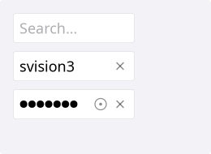
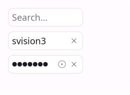
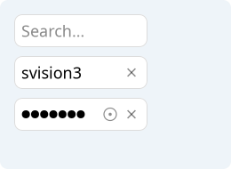
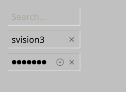
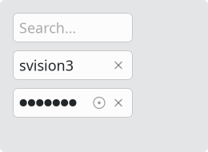
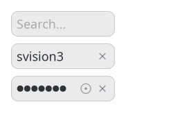

# LineInput

`#include "toolkit/line_input.hpp"`

A single-line text input with selection, clipboard (cut/copy/paste),
undo/redo, password mode, validation, a right-hand-side clear/peek button,.
Inherits `Widget`.

Features:

* Clear button.
* Can be read only.
* Can display a "hint" when no text is set.
* Password mode (which shows another peel button on the side),`
* Validator - which can also prevent adding invalid text.
* Undo/Redo system (with merging of similar events).
* Copy/paste/cut and right click menu.

<Tabs>
<TabItem value="macos" label="macOS">



</TabItem>
<TabItem value="material" label="Material">



</TabItem>
<TabItem value="windows-11" label="Windows 11">



</TabItem>
<TabItem value="windows-95" label="Windows 95">



</TabItem>
<TabItem value="plasma-6" label="Plasma 6">



</TabItem>
<TabItem value="gnome" label="GNOME">



</TabItem>
</Tabs>

## Example

```cpp
auto input = std::make_unique<toolkit::LineInput>("Search…");
input->on_submit = [](std::string const &text, toolkit::LineInput &) {
    run_search(text);
};
```

## Construction

```cpp
explicit LineInput(std::string placeholder = "");
```

## API

| Member | Description |
|--------|-------------|
| `set_text(std::string const&)` / `text()` | Field content |
| `set_password_mode(bool)` / `is_password_mode()` | Mask input (e.g. for passwords) |
| `set_read_only(bool)` / `is_read_only()` | Disable editing while still allowing selection/copy |
| `set_validator(fn)` / `set_validation_mode(ValidationMode)` / `validation_mode()` | Validate input as it's typed |
| `is_valid()` | Whether current text passes the validator |
| `set_text_direction(TextDirection)` / `text_direction()` | `LTR \| RTL \| Auto` |
| `resolved_direction()` | The direction `Auto` currently resolves to, based on content |

`ValidationMode` is `None \| Block \| Notify` — `Block` refuses invalid
keystrokes, `Notify` allows them but flags `is_valid() == false`.

Built-in editing `Command::Ptr` members are exposed so they can be wired
into menus/toolbars/shortcuts: `select_all_cmd`, `cut_cmd`, `copy_cmd`,
`paste_cmd`, `undo_cmd`, `redo_cmd`.

## Callbacks

| Callback | Description |
|----------|-------------|
| `on_change` — `std::function<void(std::string const&, LineInput&)>` | Fired as the text changes |
| `on_submit` — `std::function<void(std::string const&, LineInput&)>` | Fired on Enter |
