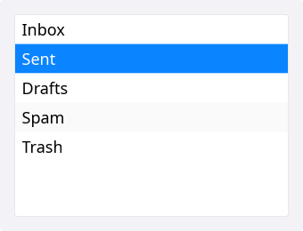
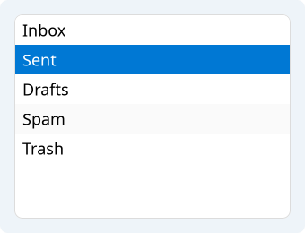
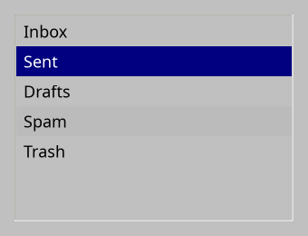
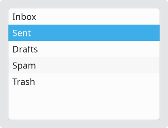
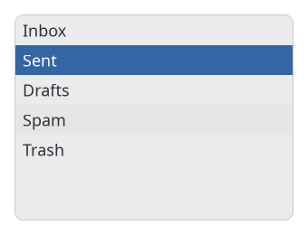

# ListView

`#include "toolkit/list_view.hpp"`

A scrollable, single-column list bound to an [`ItemModel`](item_model.md),
with single/multi selection and alternating row colors. Inherits
`ScrollableWidget`.

=== "macOS"
    

=== "Material"
    

=== "Windows 11"
    

=== "Windows 95"
    

=== "Plasma 6"
    

=== "GNOME"
    

## Example

```cpp
auto model = std::make_shared<toolkit::StringListModel>(items);
auto list = std::make_unique<toolkit::ListView>(model);
list->on_selection_changed = [](std::optional<size_t> index) { /* ... */ };
```

## Construction

```cpp
explicit ListView(std::shared_ptr<ItemModel> model);
```

## API

| Member | Description |
|--------|-------------|
| `set_model(std::shared_ptr<ItemModel>)` / `model()` | Data source |
| `set_alternating_row_colors(bool)` / `alternating_row_colors()` | Zebra-striped rows |
| `set_multi_select(bool)` / `get_multi_select()` | Allow selecting multiple rows |
| `set_selected(std::optional<size_t>)` / `selected_index()` | Single-selection cursor |
| `set_selection(std::set<size_t>)` / `selection()` | Full selection set |
| `select_all()` / `clear_selection()` | Bulk selection |
| `is_selected(size_t)` | Query one index |

## Callbacks

| Callback | Description |
|----------|-------------|
| `on_selection_changed` — `std::function<void(std::optional<size_t>)>` | Fired when the selection changes |
