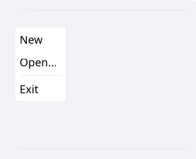
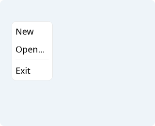
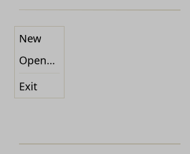
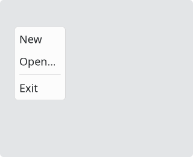
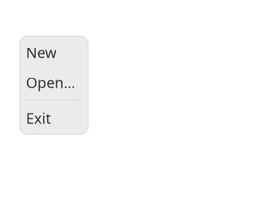

# Menu

`#include "toolkit/menu.hpp"`

A dropdown menu of actions, separators, and submenus, built from
[`Command`](command.md)s. Used both standalone (e.g. attached to a
[`Button`](button.md) via `set_menu()`) and as the per-menu content of a
[`MenuBar`](menubar.md).

=== "macOS"
    

=== "Material"
    

=== "Windows 11"
    

=== "Windows 95"
    

=== "Plasma 6"
    

=== "GNOME"
    

## Example

```cpp
auto menu = std::make_shared<toolkit::Menu>("&File");
menu->add_action("&Open…", [] { open_file(); });
menu->add_action(save_command);
menu->add_separator();
menu->add_action("E&xit", [window] { window->close(); });
```

## Construction

```cpp
explicit Menu(std::string title = "");
```

## MenuItem

```cpp
struct MenuItem {
    enum class Type { Action, Separator, Submenu };
    static MenuItem action(std::shared_ptr<Command> cmd);
    static MenuItem action(std::string name, std::function<void()> execute, bool enabled = true);
    static MenuItem sep();
    static MenuItem submenu_item(std::string name, std::shared_ptr<Menu> menu);
};
```

## API

| Member | Description |
|--------|-------------|
| `add_action(std::shared_ptr<Command>)` | Add a command-backed item |
| `add_action(std::string name, std::function<void()> execute, bool enabled = true)` | Add a simple action item |
| `add_separator()` | Add a visual separator |
| `add_submenu(std::string name, std::shared_ptr<Menu>)` | Add a nested submenu |
| `show(Window *window, Point position)` / `close()` / `is_shown()` | Display/dismiss the menu |
| `select_first()` | Move keyboard highlight to the first item |
| `title()` / `display_title()` / `mnemonic_key()` | Menu title and its parsed mnemonic |
| `items()` | Read-only access to the item list |

## Callbacks

| Callback | Description |
|----------|-------------|
| `on_request_next_menu` / `on_request_prev_menu` — `std::function<void()>` | Keyboard navigation (Left/Right) between sibling menus in a `MenuBar` |
| `on_close_callback` — `std::function<void()>` | Fired when the menu closes |
