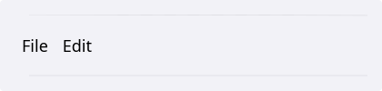
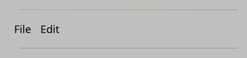

# MenuBar

`#include "toolkit/menubar.hpp"`

A horizontal bar of top-level [`Menu`](menu.md)s (File, Edit, …), with
mnemonic (Alt+letter) keyboard navigation between them. Inherits `Widget`.

<Tabs>
<TabItem value="macos" label="macOS">



</TabItem>
<TabItem value="material" label="Material">


</TabItem>
<TabItem value="windows-11" label="Windows 11">


</TabItem>
<TabItem value="windows-95" label="Windows 95">



</TabItem>
<TabItem value="plasma-6" label="Plasma 6">


</TabItem>
<TabItem value="gnome" label="GNOME">


</TabItem>
</Tabs>

## Example

```cpp
auto menubar = std::make_unique<toolkit::MenuBar>();
auto file_menu = menubar->add_menu("&File");
file_menu->add_action("&Open…", [] { open_file(); });
```

## Construction

```cpp
MenuBar();
```

## API

| Member | Description |
|--------|-------------|
| `add_menu(std::shared_ptr<Menu>)` | Add an existing menu |
| `add_menu(std::string title)` → `std::shared_ptr<Menu>` | Create, add, and return a new menu |
| `toggle_menu(int index)` | Open/close a top-level menu programmatically |
| `find_menu(std::string_view title)` | Look up a menu's index by title |
| `set_show_mnemonics(bool)` | Show underlined mnemonics (normally only while Alt is held) |
