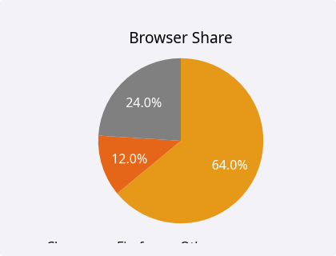
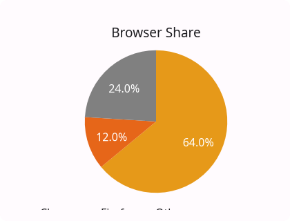
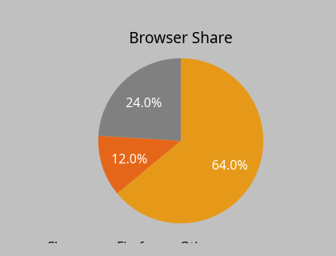
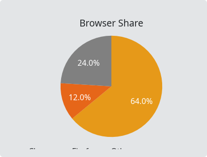

# PieChart

`#include "toolkit/charts/pie_chart.hpp"`

A pie (or donut) chart with optional legend and slice labels. Unlike the
other chart widgets, it has no axes/grid and doesn't use `ChartInteraction`
pan/zoom. Inherits `Widget`.

=== "macOS"
    

=== "Material"
    

=== "Windows 11"
    

=== "Windows 95"
    

=== "Plasma 6"
    

=== "GNOME"
    

## Data type

```cpp
struct PieSlice { std::string label; float value; Color color; };
```

## Example

```cpp
auto chart = std::make_unique<toolkit::PieChart>();
chart->set_slices({
    {"Chrome", 64, toolkit::Color::rgb(0.9f, 0.6f, 0.1f)},
    {"Firefox", 12, toolkit::Color::rgb(0.9f, 0.4f, 0.1f)},
    {"Other", 24, toolkit::Color::rgb(0.5f, 0.5f, 0.5f)},
});
chart->set_donut(true);
```

## Construction

```cpp
PieChart();
```

## API

| Member | Description |
|--------|-------------|
| `set_slices(std::vector<PieSlice>)` / `clear()` / `slice_count()` | Set the pie's data |
| `set_title(std::string)` | Chart title |
| `set_donut(bool)` | Render as a donut (ring) instead of a filled pie |
| `set_show_legend(bool)` / `set_show_labels(bool)` | Toggle chrome |

## Callbacks

| Callback | Description |
|----------|-------------|
| `on_hover` — `std::function<void(size_t slice_idx)>` | Fired as the pointer hovers a slice |
