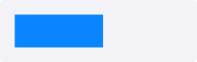

# ProgressBar

`#include "toolkit/progress_bar.hpp"`

A simple, non-interactive progress indicator over a `0.0`–`1.0` range.
Inherits `Widget`.

=== "macOS"
    

=== "Material"
    

=== "Windows 11"
    

=== "Windows 95"
    

=== "Plasma 6"
    

=== "GNOME"
    

## Example

```cpp
auto bar = std::make_unique<toolkit::ProgressBar>();
bar->set_value(0.42f);
```

## Construction

```cpp
ProgressBar();
```

## API

| Member | Description |
|--------|-------------|
| `set_value(float)` / `value()` | Progress fraction |
