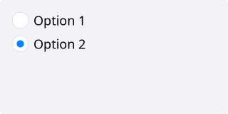

# RadioButton

`#include "toolkit/radio_button.hpp"`

A single radio button that belongs to a `RadioGroup`, which enforces
mutual exclusivity across all radio buttons registered with it. Inherits
`Widget`.

=== "macOS"
    

=== "Material"
    

=== "Windows 11"
    

=== "Windows 95"
    

=== "Plasma 6"
    

=== "GNOME"
    

## RadioGroup

```cpp
class RadioGroup {
  public:
    void add(RadioButton *rb);
    void select(RadioButton *rb);
    std::function<void(int index)> on_change;
};
```

Create one `RadioGroup` per set of mutually-exclusive options; each
`RadioButton` registers itself with the group it's constructed with.

## Example

```cpp
toolkit::RadioGroup group;
auto opt1 = std::make_unique<toolkit::RadioButton>("Option &1", group);
auto opt2 = std::make_unique<toolkit::RadioButton>("Option &2", group);
group.on_change = [](int index) { /* ... */ };
```

## Construction

```cpp
RadioButton(std::string text, RadioGroup &group);
```

## API

| Member | Description |
|--------|-------------|
| `selected()` / `set_selected(bool)` | Whether this button is the selected one in its group |
