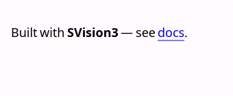
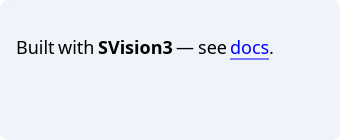
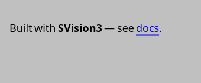
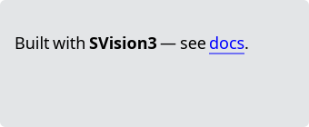

# RichLabel

`#include "toolkit/rich_label.hpp"`

A rich-text label: a thin, label-like wrapper around
[`HtmlView`](html_view.md) for short inline Markdown/HTML content (as
opposed to `HtmlView` used as a full scrollable document view). Inherits
`HtmlView`.

<Tabs>
<TabItem value="macos" label="macOS">


</TabItem>
<TabItem value="material" label="Material">



</TabItem>
<TabItem value="windows-11" label="Windows 11">



</TabItem>
<TabItem value="windows-95" label="Windows 95">



</TabItem>
<TabItem value="plasma-6" label="Plasma 6">



</TabItem>
<TabItem value="gnome" label="GNOME">


</TabItem>
</Tabs>

## Example

```cpp
auto label = std::make_unique<toolkit::RichLabel>();
label->set_markdown("Built with **SVision3** — see [docs](https://example.com).");
```

## Construction

```cpp
RichLabel();
explicit RichLabel(std::string text);
```

## API

| Member | Description |
|--------|-------------|
| `set_text(std::string const&)` / `text()` | Plain/HTML text content |
| `set_markdown(std::string const&)` | Set content as Markdown |

All of `HtmlView`'s API (`set_css`, `on_link_click`, `set_content_margin`,
etc.) is also available.
