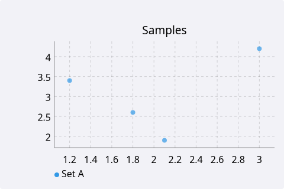
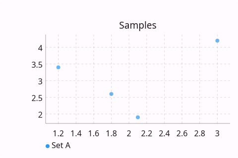
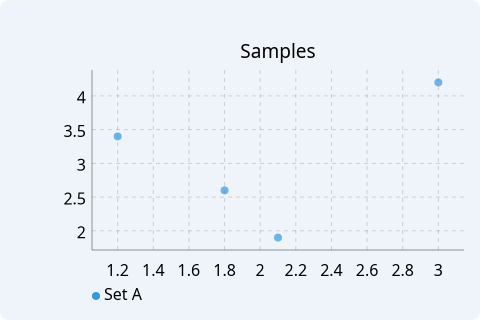
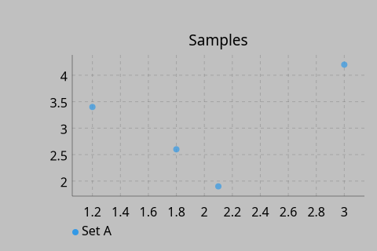
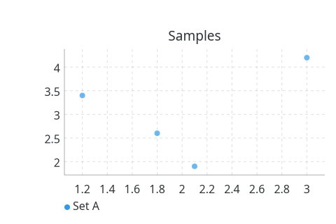

# ScatterPlot

`#include "toolkit/charts/scatter_plot.hpp"`

A multi-series scatter plot with grid, legend, hover tooltips, and pan &
zoom (see the [charts overview](charts_overview.md)). Inherits `Widget`.

<Tabs>
<TabItem value="macos" label="macOS">



</TabItem>
<TabItem value="material" label="Material">



</TabItem>
<TabItem value="windows-11" label="Windows 11">



</TabItem>
<TabItem value="windows-95" label="Windows 95">



</TabItem>
<TabItem value="plasma-6" label="Plasma 6">


</TabItem>
<TabItem value="gnome" label="GNOME">



</TabItem>
</Tabs>

## Data types

```cpp
struct ScatterPoint { float x, y; std::string label; };
struct ScatterSeries { std::string name; Color color; float point_radius = 3.0f; std::vector<ScatterPoint> points; };
```

## Example

```cpp
auto chart = std::make_unique<toolkit::ScatterPlot>();
chart->add_series({"Samples", toolkit::Color::rgb(0.2f, 0.6f, 0.9f), 4.0f,
                    {{1.2f, 3.4f, ""}, {2.1f, 1.9f, ""}}});
```

## Construction

```cpp
ScatterPlot();
```

## API

| Member | Description |
|--------|-------------|
| `add_series(ScatterSeries)` / `clear_series()` / `series_count()` | Manage data series |
| `set_title(std::string)` | Chart title |
| `set_x_label(std::string)` / `set_y_label(std::string)` | Axis labels |
| `set_show_grid(bool)` / `set_show_legend(bool)` | Toggle chrome |

## Callbacks

| Callback | Description |
|----------|-------------|
| `on_hover` — `std::function<void(size_t series_idx, size_t point_idx)>` | Fired as the pointer hovers a point |
