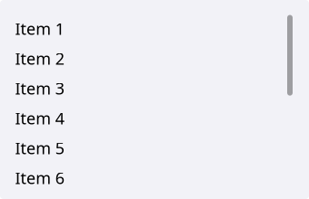
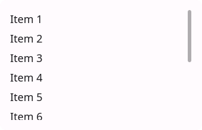
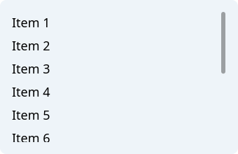
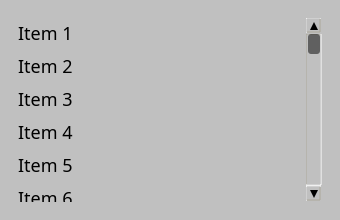
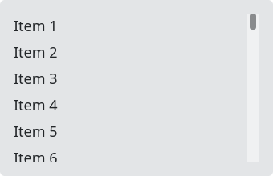
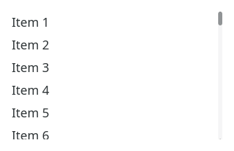

# ScrollArea

`#include "toolkit/scroll_area.hpp"`

A generic scrollable container: set any widget as content and `ScrollArea`
clips and scrolls it — the widget itself keeps its natural size from
`size_hint()`. Inherits [`ScrollableWidget`](scrollable_widget.md).

=== "macOS"
    

=== "Material"
    

=== "Windows 11"
    

=== "Windows 95"
    

=== "Plasma 6"
    

=== "GNOME"
    

## Example

```cpp
auto area = std::make_unique<toolkit::ScrollArea>();
area->set_content(make_long_form());
```

## Construction

```cpp
ScrollArea();
```

## API

| Member | Description |
|--------|-------------|
| `set_content(std::shared_ptr<Widget>)` → `weak_ptr<Widget>` | Set the scrolled content widget |
| `content()` | Currently set content |

Also inherits `scroll_to()`, `scroll_x()`, `scroll_y()` from
`ScrollableWidget`.
