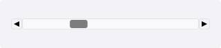
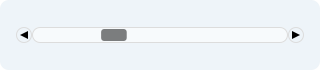
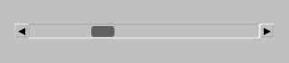

# Scrollbar

`#include "toolkit/scrollbar.hpp"`

A standalone horizontal or vertical scrollbar with stepper buttons, a
draggable thumb, and small/page step sizes. Used internally by
[`ScrollableWidget`](scrollable_widget.md), but usable standalone as a
generic ranged control. Inherits `Widget`.

=== "macOS"
    

=== "Material"
    

=== "Windows 11"
    

=== "Windows 95"
    

=== "Plasma 6"
    

=== "GNOME"
    

## Construction

```cpp
explicit Scrollbar(Orientation o = Orientation::Horizontal);
```

## API

| Member | Description |
|--------|-------------|
| `set_value(float)` / `value()` | Current position |
| `set_range(float min, float max)` / `min()` / `max()` | Value range |
| `set_step_small(float)` | Step size for the stepper buttons/arrow keys |
| `set_step_page(float)` | Step size for track (page) clicks |
| `is_dragging()` | Whether the thumb is currently being dragged |

## Callbacks

| Callback | Description |
|----------|-------------|
| `on_change` — `std::function<void(float)>` | Fired with the new value whenever it changes |
