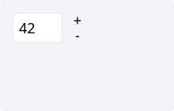
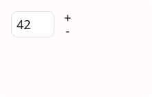
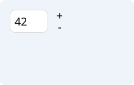
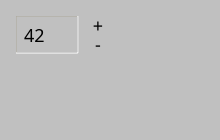
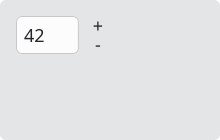
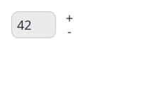

# SpinBox

`#include "toolkit/spin_box.hpp"`

A numeric input with up/down step buttons and a typable, editable text
field. Inherits `Widget`.

<Tabs>
<TabItem value="macos" label="macOS">



</TabItem>
<TabItem value="material" label="Material">



</TabItem>
<TabItem value="windows-11" label="Windows 11">



</TabItem>
<TabItem value="windows-95" label="Windows 95">



</TabItem>
<TabItem value="plasma-6" label="Plasma 6">



</TabItem>
<TabItem value="gnome" label="GNOME">



</TabItem>
</Tabs>

## Example

```cpp
auto spin = std::make_unique<toolkit::SpinBox>(50, 0, 100, 5);
spin->on_change = [](int value, toolkit::SpinBox &) { /* ... */ };
```

## Construction

```cpp
explicit SpinBox(int value = 0, int min_val = 0, int max_val = 100, int step = 1);
```

## API

| Member | Description |
|--------|-------------|
| `value()` / `set_value(int)` | Current value (clamped to range) |
| `set_range(int min, int max)` | Update the allowed range |
| `set_step(int)` | Increment applied by the up/down buttons |

## Callbacks

| Callback | Description |
|----------|-------------|
| `on_change` — `std::function<void(int value, SpinBox&)>` | Fired when the value changes |
