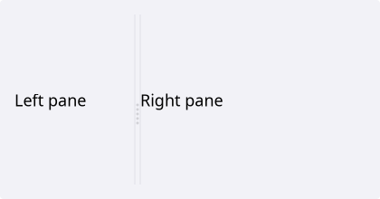
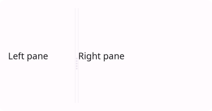
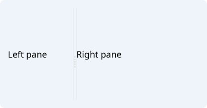
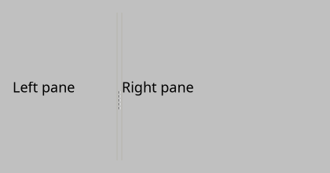
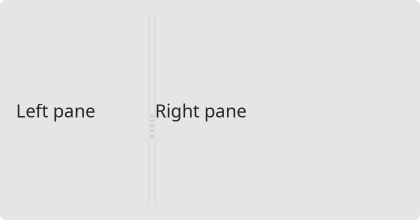
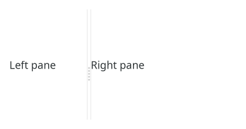

# Splitter

`#include "toolkit/splitter.hpp"`

A resizable multi-pane container: children are separated by draggable
dividers. Ratios, per-divider locking, and per-child resize stretch
factors are all configurable. [`DockArea`](dock_area.md) builds a nested
tree of `Splitter`s internally. Inherits `Widget`.

<Tabs>
<TabItem value="macos" label="macOS">



</TabItem>
<TabItem value="material" label="Material">



</TabItem>
<TabItem value="windows-11" label="Windows 11">



</TabItem>
<TabItem value="windows-95" label="Windows 95">



</TabItem>
<TabItem value="plasma-6" label="Plasma 6">



</TabItem>
<TabItem value="gnome" label="GNOME">



</TabItem>
</Tabs>

## Example

```cpp
auto splitter = std::make_unique<toolkit::Splitter>();
splitter->add_child(make_sidebar());
splitter->add_child(make_main_view());
splitter->set_ratio(0.25f);
```

## Construction

```cpp
explicit Splitter(Orientation o = Orientation::Horizontal);
```

## API

| Member | Description |
|--------|-------------|
| `add_child(shared_ptr<Widget>)` → `weak_ptr<Widget>` | Append a pane; a new divider is created before it |
| `insert_child(size_t index, shared_ptr<Widget>)` → `weak_ptr<Widget>` | Insert a pane at a position |
| `remove_child(size_t index)` | Remove a pane and its adjacent divider |
| `child_count()` / `child_at(size_t)` | Introspect children |
| `set_ratio(int divider, float r)` / `ratio(int divider)` | Divider position as a `0..1` fraction of total extent |
| `set_ratio(float r)` / `ratio()` | Convenience overload for the common 2-child case (divider 0) |
| `set_divider_locked(int, bool)` / `is_divider_locked(int)` | Hide and freeze a specific divider |
| `set_locked(bool)` / `locked()` | Lock/query all dividers at once |
| `set_stretch_factor(int child, float factor)` / `stretch_factor(int child)` | How much a child absorbs of a splitter *resize* (not user dragging); `0` keeps its pixel size |
| `orientation()` | `Horizontal \| Vertical` |
