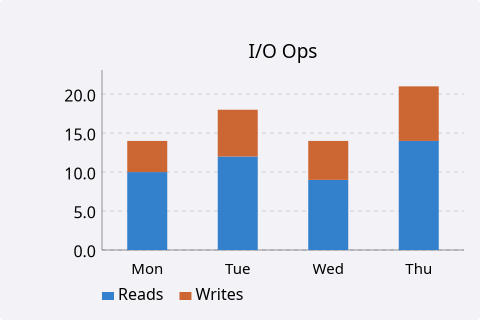
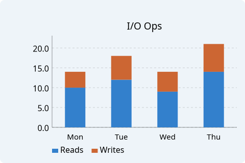
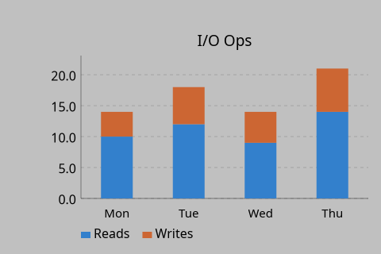
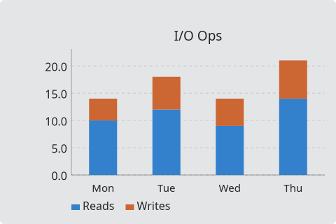
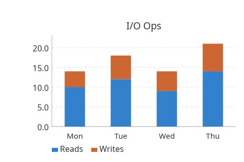

# StackedBarChart

`#include "toolkit/charts/stacked_bar_chart.hpp"`

A stacked (or normalized/100%) bar chart over a shared set of categories,
with grid, legend, hover tooltips, and pan & zoom (see the
[charts overview](charts_overview.md)). Inherits `Widget`.

<Tabs>
<TabItem value="macos" label="macOS">



</TabItem>
<TabItem value="material" label="Material">


</TabItem>
<TabItem value="windows-11" label="Windows 11">



</TabItem>
<TabItem value="windows-95" label="Windows 95">



</TabItem>
<TabItem value="plasma-6" label="Plasma 6">



</TabItem>
<TabItem value="gnome" label="GNOME">



</TabItem>
</Tabs>

## Data types

```cpp
struct StackedBarCategory { float x; std::string label; };
struct StackedBarSeries { std::string name; Color color; std::vector<float> values; };
```

Each series' `values` are aligned positionally with `set_categories()`.

## Example

```cpp
auto chart = std::make_unique<toolkit::StackedBarChart>();
chart->set_categories({{0, "Mon"}, {1, "Tue"}, {2, "Wed"}});
chart->add_series({"Reads", toolkit::Color::rgb(0.2f, 0.5f, 0.8f), {10, 12, 9}});
chart->add_series({"Writes", toolkit::Color::rgb(0.8f, 0.4f, 0.2f), {4, 6, 5}});
```

## Construction

```cpp
StackedBarChart();
```

## API

| Member | Description |
|--------|-------------|
| `set_categories(std::vector<StackedBarCategory>)` | Define the shared X-axis categories |
| `add_series(StackedBarSeries)` / `clear()` / `series_count()` | Manage data series |
| `set_normalized(bool)` | Stack as 100% relative shares instead of absolute values |
| `set_title(std::string)` | Chart title |
| `set_x_label(std::string)` / `set_y_label(std::string)` | Axis labels |
| `set_show_grid(bool)` / `set_show_legend(bool)` | Toggle chrome |

## Callbacks

| Callback | Description |
|----------|-------------|
| `on_hover` — `std::function<void(size_t series_idx, size_t category_idx)>` | Fired as the pointer hovers a segment |
