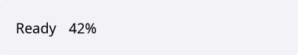

# StatusBar

`#include "toolkit/status_bar.hpp"`

A row of named, independently updatable text sections — e.g. for showing
status messages, progress, or a spinner at the bottom of a window.
Inherits `Widget`.

<Tabs>
<TabItem value="macos" label="macOS">



</TabItem>
<TabItem value="material" label="Material">


</TabItem>
<TabItem value="windows-11" label="Windows 11">


</TabItem>
<TabItem value="windows-95" label="Windows 95">


</TabItem>
<TabItem value="plasma-6" label="Plasma 6">


</TabItem>
<TabItem value="gnome" label="GNOME">


</TabItem>
</Tabs>

## Example

```cpp
auto status = std::make_unique<toolkit::StatusBar>();
status->add_section("state", "Ready");
status->section("state")->set_text("Loading…").spinner();
```

## Construction

```cpp
StatusBar();
```

## API

| Member | Description |
|--------|-------------|
| `add_section(std::string id, std::string text = "")` → `StatusBarSection&` | Add a named section |
| `section(std::string const &id)` → `StatusBarSection*` | Look up a section, or `nullptr` |
| `remove_section(std::string const &id)` | Remove a section |
| `clear()` | Remove all sections |

### StatusBarSection

| Member | Description |
|--------|-------------|
| `set_text(std::string const&)` / `text()` | Section content |
| `show()` / `hide()` / `is_visible()` | Visibility |
| `appear(int char_interval_ms = 250)` | Animate text appearing one character at a time |
| `spinner(int frame_interval_ms = 100)` | Show an animated spinner prefix |
| `pulse(int frame_interval_ms = 100)` | Pulse/fade animation |
| `set_effect(std::unique_ptr<TextEffect>)` / `clear_effect()` | Set a custom animation effect |
| `display_text()` | Text as currently rendered (post-effect) |
