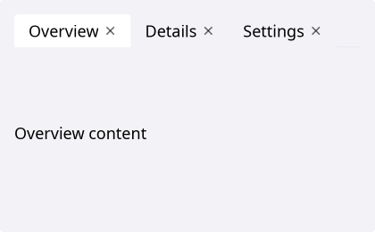
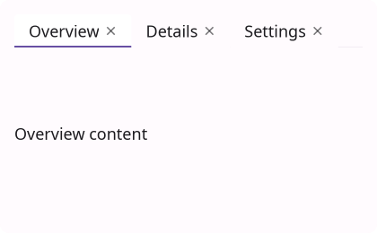
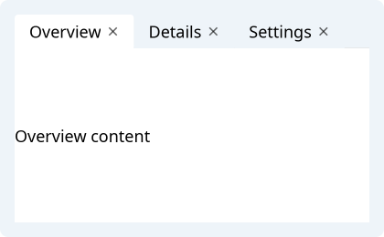
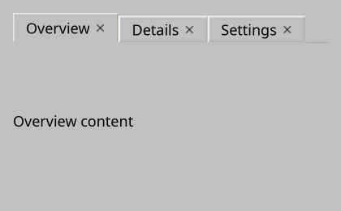
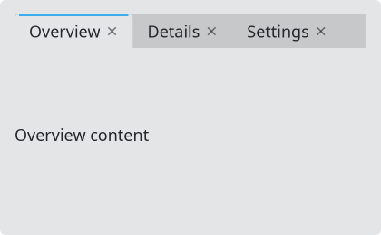
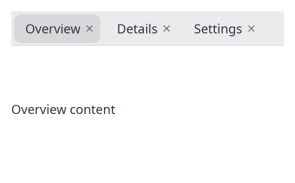

# TabWidget

`#include "toolkit/tab_widget.hpp"`

A tabbed container: each tab owns one content widget, with closable,
movable, and collapsible tabs, plus optional leading/trailing accessory
widgets in the tab bar. Used both as a plain tab strip and, via
[`DockArea`](dock_area.md), as the panel host for docking. Inherits
`Widget`.

=== "macOS"
    

=== "Material"
    

=== "Windows 11"
    

=== "Windows 95"
    

=== "Plasma 6"
    

=== "GNOME"
    

## Example

```cpp
auto tabs = std::make_unique<toolkit::TabWidget>();
tabs->add_tab("Overview", make_overview_widget());
tabs->add_tab("Details", make_details_widget());
tabs->on_current_changed = [](int index) { /* ... */ };
```

## Construction

```cpp
TabWidget();
```

## API

| Member | Description |
|--------|-------------|
| `add_tab(std::string title, std::shared_ptr<Widget> content, bool closable = true)` → `weak_ptr<Widget>` | Add a tab |
| `remove_tab(int index)` | Remove a tab |
| `get_current_index()` / `set_current(int)` | Active tab |
| `get_tab_count()` | Number of tabs |
| `get_tab_title(int)` / `set_tab_tooltip(int, std::string)` | Per-tab metadata |
| `get_widget(int)` / `get_current_widget()` | Content widget for a tab |
| `set_tabs_closable(bool)` / `tabs_closable()` | Show close (×) buttons |
| `set_tabs_movable(bool)` / `tabs_movable()` | Allow drag-reordering tabs |
| `set_min_tab_width(float)` / `min_tab_width()` | Minimum tab header width |
| `set_focus_on_tab_click(bool)` / `focus_on_tab_click()` | Whether clicking a tab header also moves keyboard focus into the widget |
| `set_collapsible(bool)` / `is_collapsible()` | Allow collapsing to just the tab bar |
| `set_collapsed(bool)` / `is_collapsed()` | Collapse state |
| `set_orientation(TabOrientation)` / `orientation()` | `North \| South \| East \| West \| WestVertical \| EastVertical` |
| `set_leading_widget(shared_ptr<Widget>)` / `set_trailing_widget(...)` | Accessory widgets in the tab bar |
| `scroll_to_tab(int)` / `scroll_by(float)` | Scroll an overflowing tab bar |

## Callbacks

| Callback | Description |
|----------|-------------|
| `on_tab_close` — `std::function<void(int index, std::string const &title)>` | Fired when a tab's close button is clicked |
| `on_current_changed` — `std::function<void(int index)>` | Fired whenever the active tab changes |
| `on_collapsed` — `std::function<void(bool collapsed)>` | Fired when collapse state changes |
