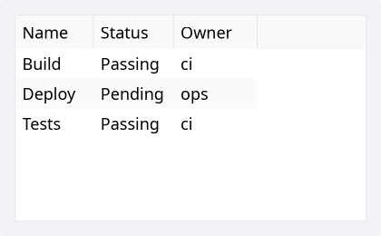
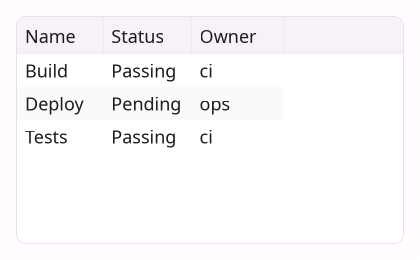
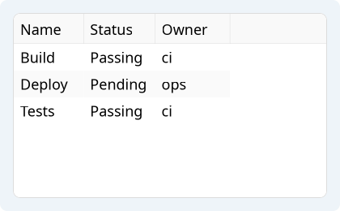
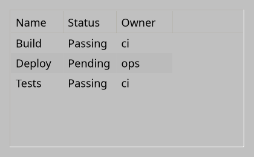
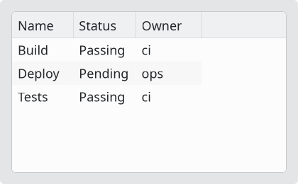
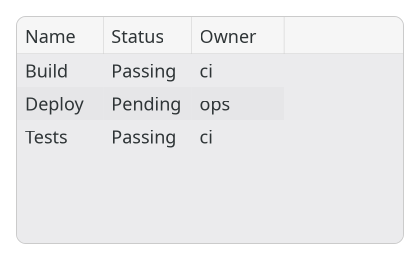

# TableView

`#include "toolkit/table_view.hpp"`

A scrollable, multi-column table bound to an [`ItemModel`](item_model.md),
with a resizable/sortable header, selection, per-column comparators, row
tooltips, and a row context-menu hook. Inherits `ScrollableWidget`.

<Tabs>
<TabItem value="macos" label="macOS">



</TabItem>
<TabItem value="material" label="Material">



</TabItem>
<TabItem value="windows-11" label="Windows 11">



</TabItem>
<TabItem value="windows-95" label="Windows 95">



</TabItem>
<TabItem value="plasma-6" label="Plasma 6">



</TabItem>
<TabItem value="gnome" label="GNOME">



</TabItem>
</Tabs>

## Example

```cpp
auto model = std::make_shared<toolkit::StringTableModel>(headers, rows);
auto table = std::make_unique<toolkit::TableView>(model);
table->set_multi_select(true);
table->on_sort_requested = [](int col, toolkit::SortOrder order) { /* re-sort model */ };
```

## Construction

```cpp
explicit TableView(std::shared_ptr<ItemModel> model);
```

## API

| Member | Description |
|--------|-------------|
| `set_model(std::shared_ptr<ItemModel>)` / `model()` | Data source |
| `set_selected_row(std::optional<size_t>)` / `selected_row()` | Single-selection cursor |
| `set_selection(std::set<size_t>)` / `selection()` | Full selection set |
| `select_all()` / `clear_selection()` / `is_selected(size_t)` | Manage selection |
| `set_multi_select(bool)` / `multi_select()` | Allow selecting multiple rows |
| `set_alternating_row_colors(bool)` / `alternating_row_colors()` | Zebra-striped rows |
| `set_show_header(bool)` / `show_header()` | Toggle the column header |
| `set_column_width(int, float)` / `column_width(int)` | Column sizing |
| `auto_fit_columns()` / `auto_fit_column(int)` | Size columns to their content |
| `set_column_comparator(int column, CellComparator)` | Custom ascending-order comparator for a column (default: lexicographic `cell_text()`) |
| `set_row_tooltip_provider(fn)` / `set_row_markdown_tooltip_provider(fn)` | Build a row's tooltip on demand, as plain text or markdown |
| `set_row_context_menu_handler(fn)` | Called with `(model_row, window_pos)` on right-click, ready to feed `ContextMenu::show()` |
| `sort_column()` / `sort_order()` | Current sort state |

`SortOrder` is `None \| Ascending \| Descending`.

## Callbacks

| Callback | Description |
|----------|-------------|
| `on_selection_changed` — `std::function<void(std::optional<size_t>)>` | Selection changed |
| `on_sort_requested` — `std::function<void(int column, SortOrder)>` | User clicked a sortable header |
| `on_item_activated` — `std::function<void(size_t row)>` | Row double-clicked / activated |
| `on_back_requested` — `std::function<void()>` | "Navigate up" gesture |
