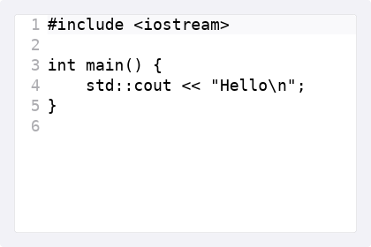
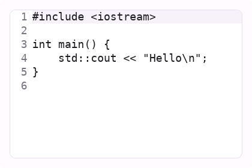
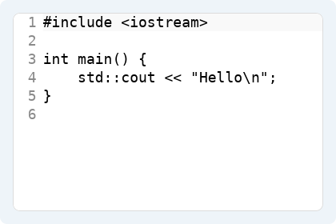
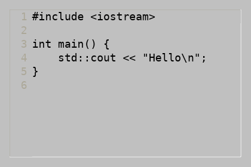
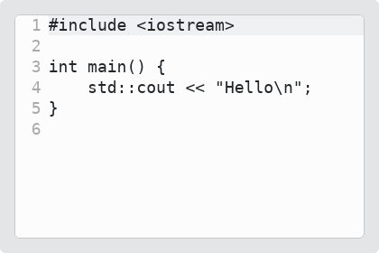
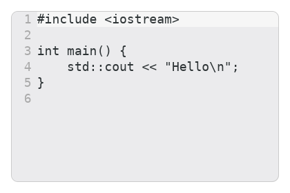

# TextEdit

`#include "toolkit/text_edit.hpp"`

A multi-line, scrollable plain-text editor with selection, clipboard,
undo/redo, a line gutter, and current-line highlighting. Inherits
`ScrollableWidget`.

=== "macOS"
    

=== "Material"
    

=== "Windows 11"
    

=== "Windows 95"
    

=== "Plasma 6"
    

=== "GNOME"
    

## Example

```cpp
auto editor = std::make_unique<toolkit::TextEdit>("// start typing…");
editor->set_highlight_current_line(true);
```

## Construction

```cpp
explicit TextEdit(std::string text = "");
```

## API

| Member | Description |
|--------|-------------|
| `text()` / `set_text(std::string const&)` | Full document content |
| `set_highlight_current_line(bool)` / `highlight_current_line()` | Highlight the line the cursor is on |

`Position { size_t line, col; }` is a nested type identifying a cursor
location; it's ordered (`<`, `<=`) so ranges can be compared.

Built-in editing `Command::Ptr` members, wireable into menus/toolbars/
shortcuts: `select_all_cmd`, `cut_cmd`, `copy_cmd`, `paste_cmd`,
`undo_cmd`, `redo_cmd`.

## Callbacks

| Callback | Description |
|----------|-------------|
| `on_change` — `std::function<void()>` | Fired whenever the document content changes |
