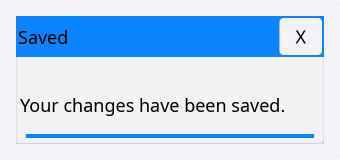
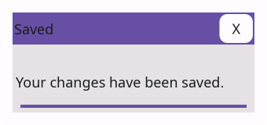
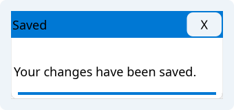
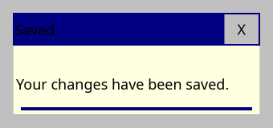
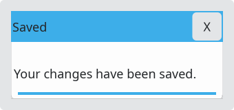
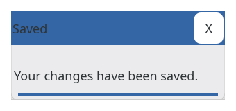

# ToastWidget

`#include "toolkit/toast_widget.hpp"`

A transient notification popup with a title, body text (plain or rich),
a close button, and an auto-dismiss timeout. Inherits `Widget`.

=== "macOS"
    

=== "Material"
    

=== "Windows 11"
    

=== "Windows 95"
    

=== "Plasma 6"
    

=== "GNOME"
    

## Example

```cpp
auto toast = toolkit::ToastBuilder{}
                 .title("Saved")
                 .text("Your changes have been saved.")
                 .timeout(4.0f)
                 .build();
```

## Construction

Build directly, or use the `ToastBuilder` fluent factory:

```cpp
ToastWidget(std::string text, std::string title = "", std::string icon_path = "",
            float timeout = 10.0f, bool rich_text = false);
```

```cpp
class ToastBuilder {
  public:
    ToastBuilder &text(std::string t);
    ToastBuilder &rich_text(std::string t);
    ToastBuilder &title(std::string t);
    ToastBuilder &background(Color c);
    ToastBuilder &timeout(float t);
    std::unique_ptr<ToastWidget> build() const;
};
```

## API

| Member | Description |
|--------|-------------|
| `set_on_close(std::function<void()>)` | Callback fired when the toast is dismissed |
| `remaining_time()` | Seconds left before auto-dismiss |
| `update_remaining_time(float delta)` | Advance the countdown (call from your update/tick loop) |
| `is_expired()` | Whether `remaining_time() <= 0` |
| `expire()` | Force immediate expiry |
| `set_background_override(Color)` | Override the toast's background color |
