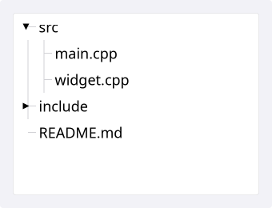
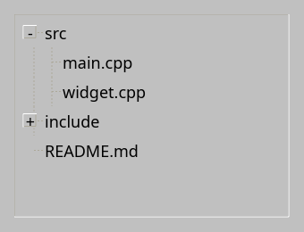
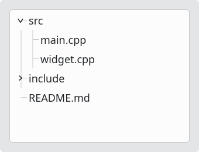
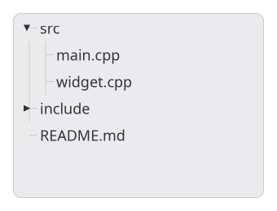

# TreeView

`#include "toolkit/tree_view.hpp"`

A scrollable, expandable/collapsible tree bound to a `TreeModel`, with
single/multi selection. Inherits `ScrollableWidget`.

<Tabs>
<TabItem value="macos" label="macOS">



</TabItem>
<TabItem value="material" label="Material">


</TabItem>
<TabItem value="windows-11" label="Windows 11">


</TabItem>
<TabItem value="windows-95" label="Windows 95">



</TabItem>
<TabItem value="plasma-6" label="Plasma 6">



</TabItem>
<TabItem value="gnome" label="GNOME">



</TabItem>
</Tabs>

## TreeModel

```cpp
struct TreeNode {
    std::string text;
    std::vector<TreeNode> children;
    bool expanded = false;
    int parent_index = -1;
    int depth = 0;
};

class TreeModel {
  public:
    virtual int root_count() const = 0;
    virtual TreeNode const &root_at(int index) const = 0;
    std::function<void()> on_data_changed;
};
```

`SimpleTreeModel` is a ready-made `TreeModel` over `std::vector<TreeNode>`
(`set_roots()`, `clear()`). [`FileTreeModel`](file_tree_model.md) is
another built-in implementation, backed by the filesystem.

## Example

```cpp
auto model = std::make_shared<toolkit::SimpleTreeModel>(build_tree());
auto tree = std::make_unique<toolkit::TreeView>(model);
```

## Construction

```cpp
explicit TreeView(std::shared_ptr<TreeModel> model);
```

## API

| Member | Description |
|--------|-------------|
| `set_model(std::shared_ptr<TreeModel>)` / `model()` | Data source |
| `expand(int node_index)` / `collapse(int node_index)` / `toggle(int node_index)` | Expansion state |
| `set_selected_node(int)` / `selected_node()` | Single-selection cursor |
| `set_selection(std::set<int>)` / `selection()` | Full selection set |
| `clear_selection()` / `is_selected(int)` | Manage selection |
| `set_multi_select(bool)` / `multi_select()` | Allow selecting multiple nodes |
| `set_alternating_row_colors(bool)` / `alternating_row_colors()` | Zebra-striped rows |

Node indices are into the view's internal flattened (visible) node list,
not the model's tree structure directly.

## Callbacks

| Callback | Description |
|----------|-------------|
| `on_selection_changed` — `std::function<void(int node_index)>` | Fired when selection changes |
| `on_node_expanded` — `std::function<void(int node_index)>` | Fired when a node is expanded/collapsed |
